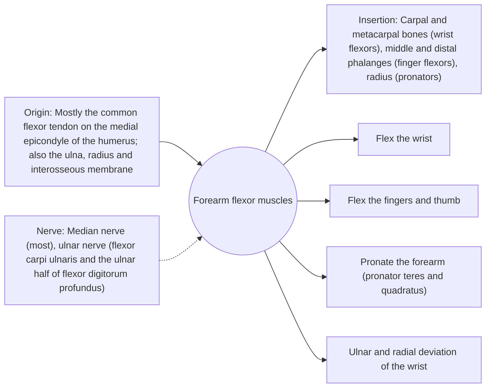

# Forearm flexor muscles

## Summary

The forearm flexors are a group of muscles on the palm side of the forearm, most arising from the medial epicondyle of the humerus. They flex the wrist and fingers, help pronate the forearm and produce grip strength. Overuse at their common origin causes golfer's elbow.

## Prerequisites

- [Muscular system overview](../muscular-system-overview.md)

## Core concepts

### Definition

The *anterior forearm compartment* contains superficial muscles (pronator teres, flexor carpi radialis, palmaris longus, flexor carpi ulnaris), an intermediate muscle (flexor digitorum superficialis) and deep muscles (flexor digitorum profundus, flexor pollicis longus, pronator quadratus).

### Analogy

The forearm flexors are like a set of puppet strings pulled from a common anchor near the elbow. Each string runs through the wrist to a finger or the hand, so muscles in the forearm move the fingers from a distance. The analogy breaks because the strings pass through a tunnel (the carpal tunnel) and their tension depends on wrist position.

### Mechanism

Grip strength depends heavily on the finger flexors and is stronger with the wrist slightly extended, because the flexor tendons are then longer. Grip strength measured with a dynamometer predicts mortality and disability in older adults in large cohort studies.

The diagram shows the attachments, the nerve and the actions.

### Attachments and innervation

| Feature | Description |
| --- | --- |
| Latin name | *musculi flexores antebrachii* |
| Origin | Mostly the common flexor tendon on the medial epicondyle of the humerus; also the ulna, radius and interosseous membrane |
| Insertion | Carpal and metacarpal bones (wrist flexors), middle and distal phalanges (finger flexors), radius (pronators) |
| Innervation | Median nerve (most), ulnar nerve (flexor carpi ulnaris and the ulnar half of flexor digitorum profundus) |
| Actions | Flex the wrist; Flex the fingers and thumb; Pronate the forearm (pronator teres and quadratus); Ulnar and radial deviation of the wrist |

### Exercises and tests

Wrist curls, farmer's carries, dead hangs, grippers.

## Worked example

Golfer's elbow (medial epicondylalgia) causes pain at the inner elbow when gripping or flexing the wrist against resistance. It is a tendinopathy of the common flexor origin and usually improves with load management and progressive strengthening over months.

## Trade offs and when to use it

Strong grip supports every pulling movement, but the common tendon is vulnerable to overuse.

## Common mistakes

- **Gripping with a fully flexed wrist.** Grip is stronger with the wrist slightly extended.

## Practice

1. From which bony landmark do most forearm flexors arise?
2. Which nerve supplies most forearm flexors?
3. What is golfer's elbow?

### Answers

1. The medial epicondyle of the humerus.
2. The median nerve.
3. Tendinopathy of the common flexor origin at the medial epicondyle.

## Further reading

- Standring, S. (Ed.) (2020). *Gray's Anatomy: The Anatomical Basis of Clinical Practice (42nd ed.)*. Elsevier. Reference text for attachments, innervation and relations.
- Betts, J. G., Young, K. A., Wise, J. A. et al. (2022). *Anatomy and Physiology 2e*. OpenStax, Rice University. [Link](https://openstax.org/details/books/anatomy-and-physiology-2e). Open textbook with illustrations of the skeletal and muscular systems.
