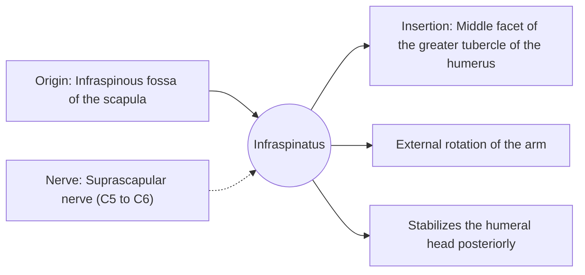

# Infraspinatus

## Summary

The infraspinatus is the rotator cuff muscle below the spine of the scapula. It is the main external rotator of the arm and holds the humeral head back against the socket.

## Prerequisites

- [Muscular system overview](../muscular-system-overview.md)

## Core concepts

### Definition

The *infraspinatus* is a thick triangular muscle filling most of the infraspinous fossa.

### Analogy

The infraspinatus is like the hand turning a doorknob outward. The analogy breaks because it also holds the knob in place while turning it.

### Mechanism

It resists forward displacement of the humeral head and is active in the follow-through of throwing as a brake.

The diagram shows the attachments, the nerve and the actions.

### Attachments and innervation

| Feature | Description |
| --- | --- |
| Latin name | *musculus infraspinatus* |
| Origin | Infraspinous fossa of the scapula |
| Insertion | Middle facet of the greater tubercle of the humerus |
| Innervation | Suprascapular nerve (C5 to C6) |
| Actions | External rotation of the arm; Stabilizes the humeral head posteriorly |

### Exercises and tests

Side-lying external rotation, band external rotation, face pulls.

## Worked example

Volleyball players sometimes show isolated wasting of the infraspinatus on the hitting side, from compression of the suprascapular nerve at the spinoglenoid notch during repeated overhead spiking.

## Trade offs and when to use it

Often weaker than the internal rotators in athletes who press and throw, which training programs aim to balance.

## Common mistakes

- **Ignoring external rotators in a bench press-heavy program.** Add external rotation work to balance the internal rotators.

## Practice

1. What is the main action of the infraspinatus?
2. Which nerve supplies it?

### Answers

1. External rotation of the arm.
2. The suprascapular nerve.

## Further reading

- Standring, S. (Ed.) (2020). *Gray's Anatomy: The Anatomical Basis of Clinical Practice (42nd ed.)*. Elsevier. Reference text for attachments, innervation and relations.
- Betts, J. G., Young, K. A., Wise, J. A. et al. (2022). *Anatomy and Physiology 2e*. OpenStax, Rice University. [Link](https://openstax.org/details/books/anatomy-and-physiology-2e). Open textbook with illustrations of the skeletal and muscular systems.
