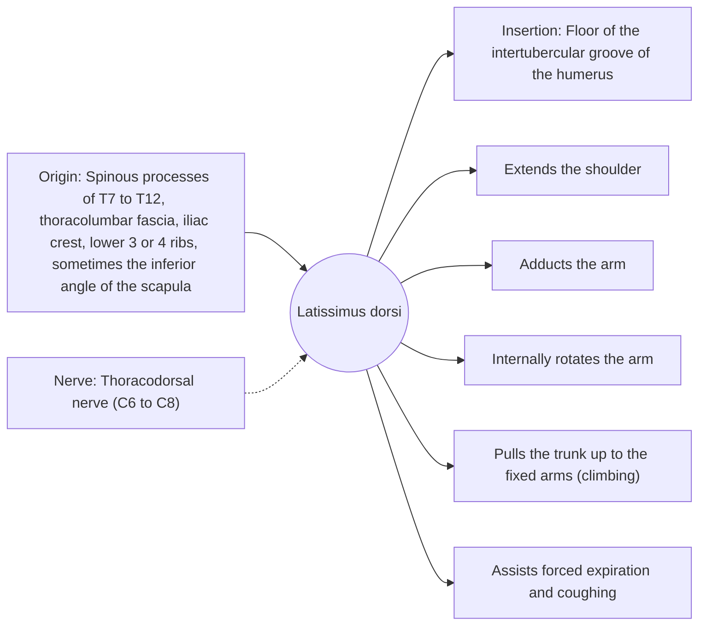

# Latissimus dorsi

## Summary

The latissimus dorsi is the broadest muscle of the back, sweeping from the lower spine and pelvis to the front of the upper humerus. It pulls the arm down and back and rotates it inward, which makes it the main muscle of pull-ups and rows. Through the thoracolumbar fascia it also links the arm to the opposite gluteus maximus.

## Prerequisites

- [Muscular system overview](../muscular-system-overview.md)

## Core concepts

### Definition

The *latissimus dorsi* ("broadest of the back") is a large, flat, triangular muscle covering the lower and middle back.

### Analogy

The latissimus is like a climbing rope attached to the arm and anchored to the pelvis: pulling it draws the arm down to the hip or, if the hand is fixed, pulls the body up to the hand. The analogy breaks because the rope twists before it attaches, so it also rotates the arm inward.

### Mechanism

In a pull-up, the arms are fixed, so the muscle pulls the trunk upward. Its attachment to the thoracolumbar fascia couples it with the opposite gluteus maximus, forming the posterior oblique sling used in walking and throwing.

The diagram shows the attachments, the nerve and the actions.

### Attachments and innervation

| Feature | Description |
| --- | --- |
| Latin name | *musculus latissimus dorsi* |
| Origin | Spinous processes of T7 to T12, thoracolumbar fascia, iliac crest, lower 3 or 4 ribs, sometimes the inferior angle of the scapula |
| Insertion | Floor of the intertubercular groove of the humerus |
| Innervation | Thoracodorsal nerve (C6 to C8) |
| Actions | Extends the shoulder; Adducts the arm; Internally rotates the arm; Pulls the trunk up to the fixed arms (climbing); Assists forced expiration and coughing |

### Exercises and tests

Pull-ups and chin-ups, lat pulldowns, rows, straight-arm pulldowns.

## Worked example

Swimmers have very developed lats, because the pull phase of freestyle is shoulder extension and adduction against water resistance. The V-shaped back of swimmers and climbers results from this.

## Trade offs and when to use it

A strong puller that can limit overhead reach when short, because it pulls the arm down and inward.

## Common mistakes

- **Pulling the bar to the neck behind the head.** Pull to the upper chest; behind-the-neck pulldowns stress the shoulder.

## Practice

1. Which nerve supplies the latissimus dorsi?
2. In which direction does the latissimus rotate the arm?

### Answers

1. The thoracodorsal nerve.
2. Inward (medially).

## Further reading

- Standring, S. (Ed.) (2020). *Gray's Anatomy: The Anatomical Basis of Clinical Practice (42nd ed.)*. Elsevier. Reference text for attachments, innervation and relations.
- Betts, J. G., Young, K. A., Wise, J. A. et al. (2022). *Anatomy and Physiology 2e*. OpenStax, Rice University. [Link](https://openstax.org/details/books/anatomy-and-physiology-2e). Open textbook with illustrations of the skeletal and muscular systems.
