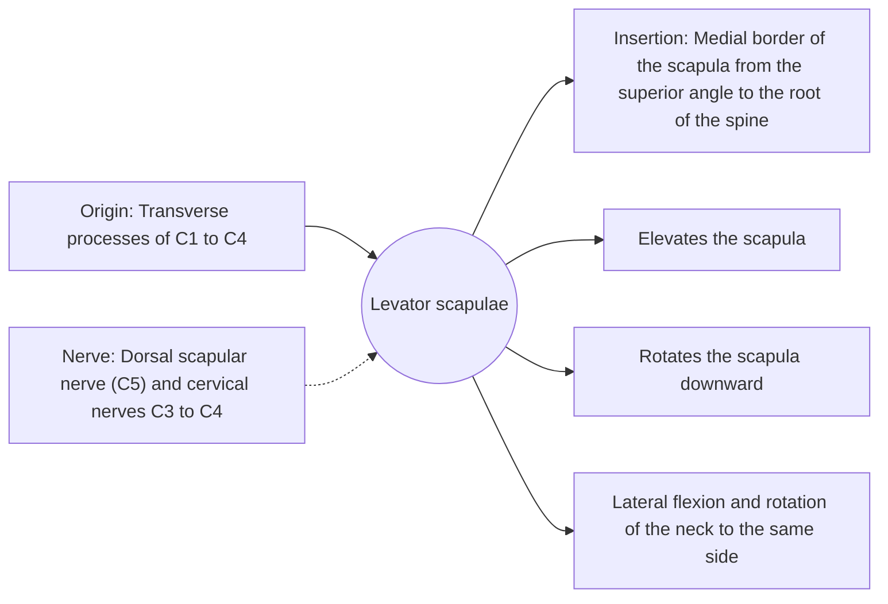

# Levator scapulae

## Summary

The levator scapulae runs from the upper cervical vertebrae to the upper inner corner of the shoulder blade. It lifts the scapula and rotates it downward, and it bends the neck to the side. It is a frequent site of the "stiff neck" felt at the top of the shoulder blade.

## Prerequisites

- [Muscular system overview](../muscular-system-overview.md)

## Core concepts

### Definition

The *levator scapulae* is a strap-like muscle in the side and back of the neck, under the sternocleidomastoid and trapezius.

### Analogy

The levator scapulae is like a cord hanging the corner of a picture frame (the scapula) from a nail on the neck. Pulling the cord lifts and tilts the frame. The analogy breaks because when the frame is fixed, the cord pulls the neck sideways instead.

### Mechanism

It works with the upper trapezius in shrugging. Turning the head to look over the shoulder when it is tight causes pain at its insertion on the superior angle.

The diagram shows the attachments, the nerve and the actions.

### Attachments and innervation

| Feature | Description |
| --- | --- |
| Latin name | *musculus levator scapulae* |
| Origin | Transverse processes of C1 to C4 |
| Insertion | Medial border of the scapula from the superior angle to the root of the spine |
| Innervation | Dorsal scapular nerve (C5) and cervical nerves C3 to C4 |
| Actions | Elevates the scapula; Rotates the scapula downward; Lateral flexion and rotation of the neck to the same side |

## Worked example

Waking with a stiff neck that hurts when turning the head to one side and is tender at the top inner corner of the shoulder blade is a typical presentation involving the levator scapulae. It usually settles within days with gentle movement.

## Trade offs and when to use it

A small muscle that is easily overloaded by sustained postures, such as holding a phone between ear and shoulder.

## Common mistakes

- **Confusing it with the upper trapezius.** The levator lies deeper and attaches to the cervical transverse processes, not the occipital bone.

## Practice

1. Where does the levator scapulae insert?
2. Name two actions of the levator scapulae.

### Answers

1. On the medial border of the scapula above the spine, at the superior angle.
2. Elevation and downward rotation of the scapula (also lateral flexion of the neck).

## Further reading

- Standring, S. (Ed.) (2020). *Gray's Anatomy: The Anatomical Basis of Clinical Practice (42nd ed.)*. Elsevier. Reference text for attachments, innervation and relations.
- Betts, J. G., Young, K. A., Wise, J. A. et al. (2022). *Anatomy and Physiology 2e*. OpenStax, Rice University. [Link](https://openstax.org/details/books/anatomy-and-physiology-2e). Open textbook with illustrations of the skeletal and muscular systems.
