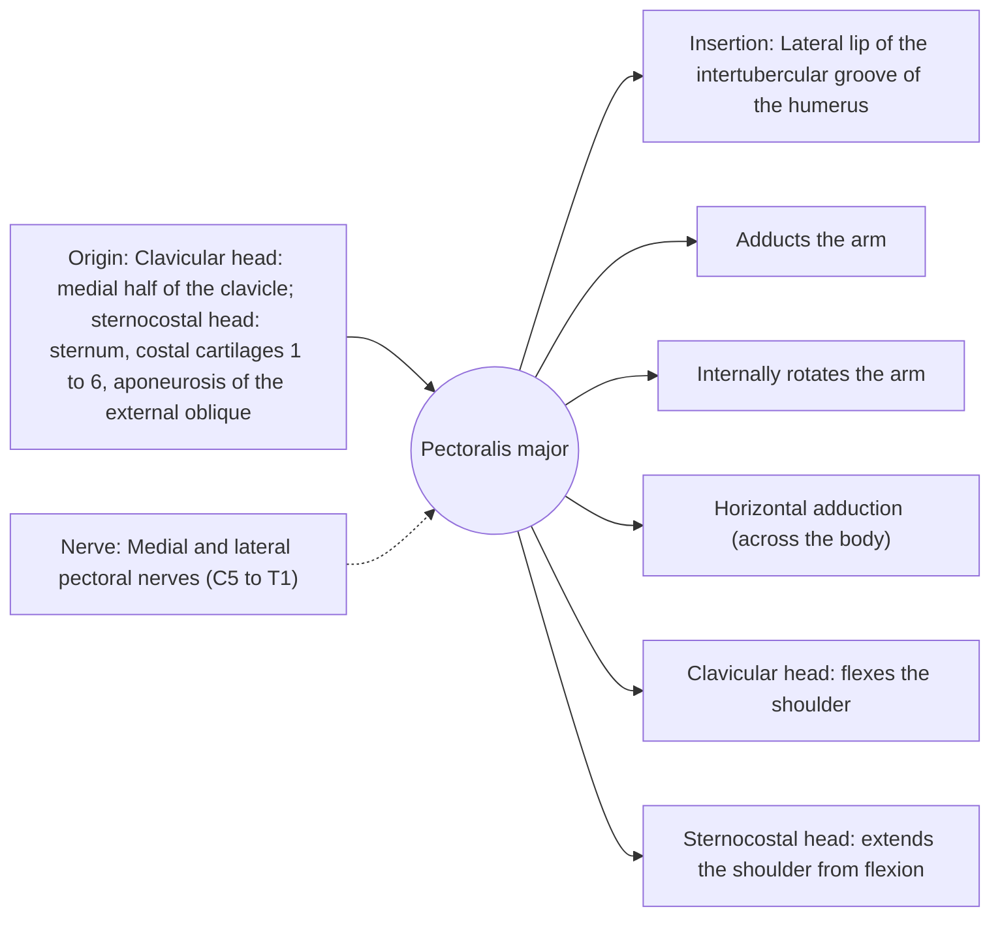

# Pectoralis major

## Summary

The pectoralis major is the large fan-shaped muscle of the chest. It adducts and internally rotates the arm and brings it forward across the body. Its clavicular part flexes the shoulder, and its sternal part extends the arm from a raised position. It is the main mover in the bench press and push-up.

## Prerequisites

- [Muscular system overview](../muscular-system-overview.md)

## Core concepts

### Definition

The *pectoralis major* has a clavicular head and a sternocostal head (with an abdominal part), converging on a twisted tendon that inserts on the humerus.

### Analogy

The pectoralis major is like a fan whose ribs converge on one handle (the tendon). Pulling the upper ribs raises the arm forward, pulling the lower ribs pulls it down and in. The analogy breaks because the tendon is twisted, so the lower fibers insert higher on the humerus than the upper fibers, keeping tension even as the arm rises.

### Mechanism

In pushing movements the pectoralis major works with the anterior deltoid and triceps. The incline press emphasizes the clavicular head and the decline press and dips the sternocostal head, although differences are modest.

The diagram shows the attachments, the nerve and the actions.

### Attachments and innervation

| Feature | Description |
| --- | --- |
| Latin name | *musculus pectoralis major* |
| Origin | Clavicular head: medial half of the clavicle; sternocostal head: sternum, costal cartilages 1 to 6, aponeurosis of the external oblique |
| Insertion | Lateral lip of the intertubercular groove of the humerus |
| Innervation | Medial and lateral pectoral nerves (C5 to T1) |
| Actions | Adducts the arm; Internally rotates the arm; Horizontal adduction (across the body); Clavicular head: flexes the shoulder; Sternocostal head: extends the shoulder from flexion |

### Exercises and tests

Bench press (flat, incline, decline), push-ups, dips, cable or dumbbell flies.

## Worked example

A pectoralis major tendon rupture typically happens in the eccentric phase of a heavy bench press, when the arm is extended and abducted. A pop, bruising and loss of the front fold of the armpit are typical, and surgical repair is often recommended for active people.

## Trade offs and when to use it

Strong but prone to injury at long lengths under heavy load; over-dominance relative to the back muscles is linked to rounded shoulder posture.

## Common mistakes

- **Bouncing the bar off the chest.** Control the eccentric phase, when the muscle is most vulnerable.

## Practice

1. Where does the pectoralis major insert?
2. Which head of the pectoralis major flexes the shoulder?

### Answers

1. On the lateral lip of the intertubercular groove of the humerus.
2. The clavicular head.

## Further reading

- Standring, S. (Ed.) (2020). *Gray's Anatomy: The Anatomical Basis of Clinical Practice (42nd ed.)*. Elsevier. Reference text for attachments, innervation and relations.
- Betts, J. G., Young, K. A., Wise, J. A. et al. (2022). *Anatomy and Physiology 2e*. OpenStax, Rice University. [Link](https://openstax.org/details/books/anatomy-and-physiology-2e). Open textbook with illustrations of the skeletal and muscular systems.
