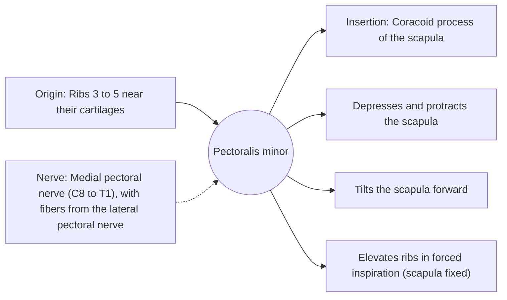

# Pectoralis minor

## Summary

The pectoralis minor is a thin triangular muscle under the pectoralis major. It runs from the third to fifth ribs to the coracoid process of the scapula and pulls the shoulder blade forward and down. A short pectoralis minor tilts the scapula forward, which is associated with rounded shoulders.

## Prerequisites

- [Muscular system overview](../muscular-system-overview.md)

## Core concepts

### Definition

The *pectoralis minor* lies deep to the pectoralis major on the front of the chest.

### Analogy

The pectoralis minor is like a short cable from the front ribs to the hook at the front of the shoulder blade. Shortening it tips the blade forward like pulling the top of a door hinge forward. The analogy breaks because, with the scapula fixed, it lifts the ribs and helps breathing.

### Mechanism

The brachial plexus and axillary vessels pass under it on their way to the arm, so it is a landmark dividing the axillary artery into three parts.

The diagram shows the attachments, the nerve and the actions.

### Attachments and innervation

| Feature | Description |
| --- | --- |
| Latin name | *musculus pectoralis minor* |
| Origin | Ribs 3 to 5 near their cartilages |
| Insertion | Coracoid process of the scapula |
| Innervation | Medial pectoral nerve (C8 to T1), with fibers from the lateral pectoral nerve |
| Actions | Depresses and protracts the scapula; Tilts the scapula forward; Elevates ribs in forced inspiration (scapula fixed) |

## Worked example

Under the pectoralis minor, the neurovascular bundle to the arm can be compressed when the arm is held overhead for long periods, one of the forms of thoracic outlet syndrome. Symptoms are tingling in the arm during overhead work.

## Trade offs and when to use it

A short pectoralis minor is common in people who sit or press a lot; stretching and back strengthening are typical responses, with modest evidence.

## Common mistakes

- **Stretching only the pectoralis major for rounded shoulders.** The pectoralis minor tilts the scapula and needs its own attention.

## Practice

1. Where does the pectoralis minor insert?
2. What passes beneath the pectoralis minor?

### Answers

1. On the coracoid process of the scapula.
2. The brachial plexus and axillary vessels.

## Further reading

- Standring, S. (Ed.) (2020). *Gray's Anatomy: The Anatomical Basis of Clinical Practice (42nd ed.)*. Elsevier. Reference text for attachments, innervation and relations.
- Betts, J. G., Young, K. A., Wise, J. A. et al. (2022). *Anatomy and Physiology 2e*. OpenStax, Rice University. [Link](https://openstax.org/details/books/anatomy-and-physiology-2e). Open textbook with illustrations of the skeletal and muscular systems.
