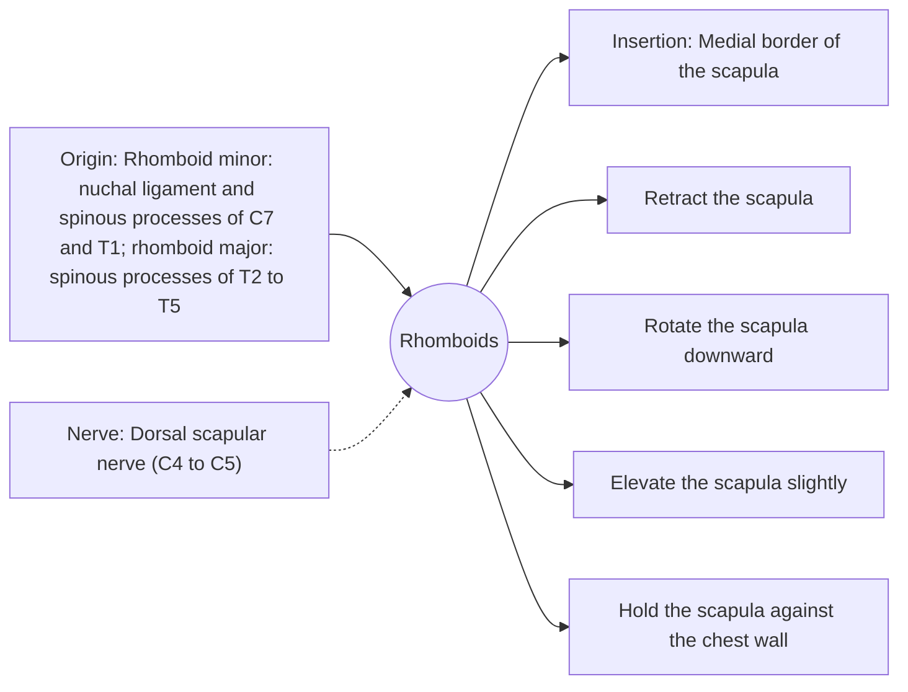

# Rhomboids

## Summary

The rhomboids (major and minor) lie under the trapezius and connect the spine to the inner border of the shoulder blade. They pull the shoulder blades together and rotate them downward. They work in rows and keep the scapula against the chest wall.

## Prerequisites

- [Muscular system overview](../muscular-system-overview.md)

## Core concepts

### Definition

The *rhomboid major* and *rhomboid minor* are flat, rhomboid-shaped muscles of the upper back.

### Analogy

The rhomboids are like the straps that pull two halves of a backpack frame together at the spine. The analogy breaks because they also rotate the frame, tilting the shoulder socket down.

### Mechanism

With the serratus anterior, the rhomboids form a sling that holds the medial border of the scapula against the ribs. Their downward rotation opposes the upward rotation of the trapezius and serratus anterior during arm raising.

The diagram shows the attachments, the nerve and the actions.

### Attachments and innervation

| Feature | Description |
| --- | --- |
| Latin name | *musculi rhomboidei* |
| Origin | Rhomboid minor: nuchal ligament and spinous processes of C7 and T1; rhomboid major: spinous processes of T2 to T5 |
| Insertion | Medial border of the scapula |
| Innervation | Dorsal scapular nerve (C4 to C5) |
| Actions | Retract the scapula; Rotate the scapula downward; Elevate the scapula slightly; Hold the scapula against the chest wall |

### Exercises and tests

Seated rows, face pulls, band pull-aparts, inverted rows.

## Worked example

Pain between the shoulder blades in people who sit hunched at a desk is often attributed to the rhomboids, which are stretched and under constant low-level load. Changing position regularly and strengthening the back muscles usually helps more than stretching alone.

## Trade offs and when to use it

Essential stabilizers that are often weak relative to the chest muscles in people who train mostly pushing movements.

## Common mistakes

- **Pulling the shoulders back and down forcefully all day.** Natural posture varies; strength and movement variety matter more than holding one position.

## Practice

1. Which nerve supplies the rhomboids?
2. Which direction do the rhomboids rotate the scapula?

### Answers

1. The dorsal scapular nerve.
2. Downward.

## Further reading

- Standring, S. (Ed.) (2020). *Gray's Anatomy: The Anatomical Basis of Clinical Practice (42nd ed.)*. Elsevier. Reference text for attachments, innervation and relations.
- Betts, J. G., Young, K. A., Wise, J. A. et al. (2022). *Anatomy and Physiology 2e*. OpenStax, Rice University. [Link](https://openstax.org/details/books/anatomy-and-physiology-2e). Open textbook with illustrations of the skeletal and muscular systems.
