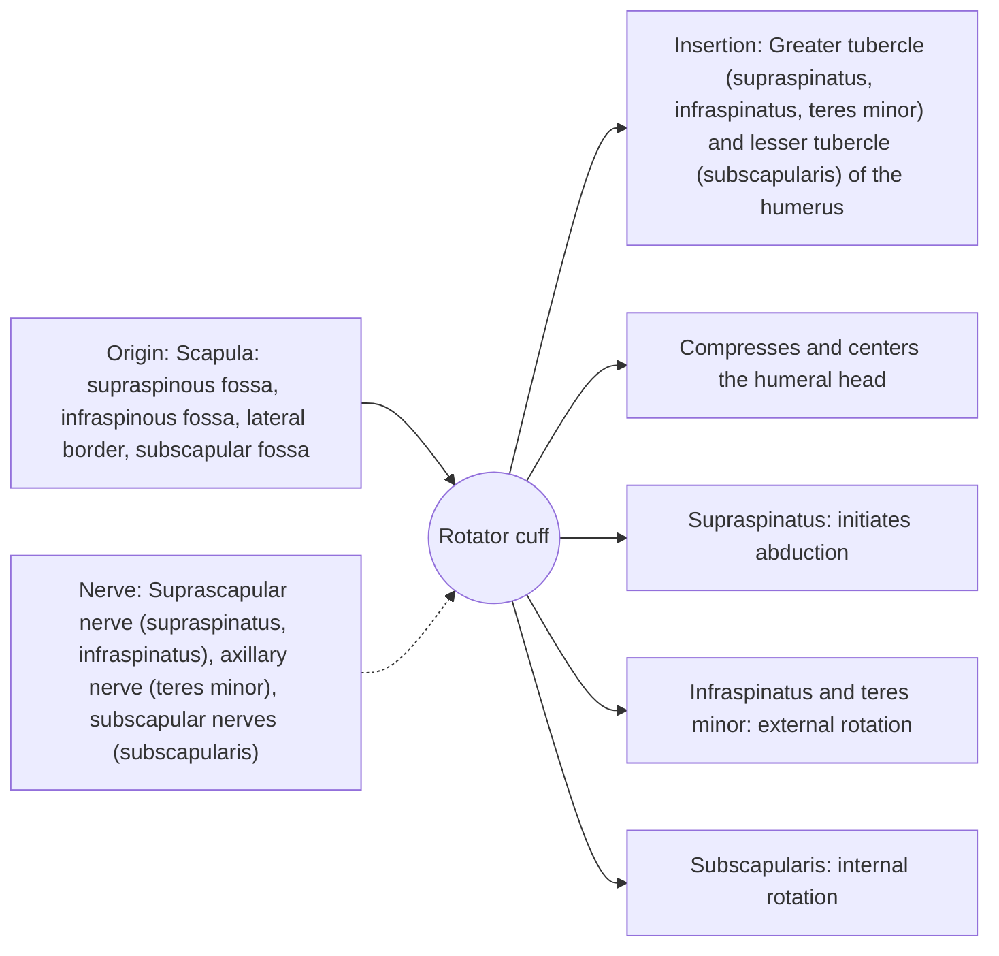

# Rotator cuff

## Summary

The rotator cuff is a group of four muscles (supraspinatus, infraspinatus, teres minor and subscapularis) whose tendons blend with the shoulder capsule and surround the humeral head. They keep the head centered in the shallow socket and rotate the arm. Rotator cuff problems are among the most common causes of shoulder pain.

## Prerequisites

- [Muscular system overview](../muscular-system-overview.md)

## Core concepts

### Definition

The *rotator cuff* (musculotendinous cuff) is formed by the tendons of four scapulohumeral muscles inserting around the humeral head. The mnemonic SITS lists them: supraspinatus, infraspinatus, teres minor, subscapularis.

### Analogy

The rotator cuff is like four fingers holding a ball (the humeral head) in a saucer (the glenoid): above, behind, below-behind and in front. They press the ball into the saucer so the big muscles (deltoid, pectoralis) can move it without it rolling off. The analogy breaks because the fingers also turn the ball (rotation).

### Mechanism

The force couple of the rotator cuff and deltoid is central to shoulder mechanics: the deltoid lifts, the cuff holds the head down and in. The supraspinatus tendon passes under the acromion, where it can be compressed or degenerate with age.

The diagram shows the attachments, the nerve and the actions.

### Attachments and innervation

| Feature | Description |
| --- | --- |
| Latin name | *cuff musculotendinea rotatorum* |
| Origin | Scapula: supraspinous fossa, infraspinous fossa, lateral border, subscapular fossa |
| Insertion | Greater tubercle (supraspinatus, infraspinatus, teres minor) and lesser tubercle (subscapularis) of the humerus |
| Innervation | Suprascapular nerve (supraspinatus, infraspinatus), axillary nerve (teres minor), subscapular nerves (subscapularis) |
| Actions | Compresses and centers the humeral head; Supraspinatus: initiates abduction; Infraspinatus and teres minor: external rotation; Subscapularis: internal rotation |

### The four muscles

| Muscle | Position | Main action | Nerve |
| --- | --- | --- | --- |
| [Supraspinatus](supraspinatus.md) | Above | Abduction (start), compression | Suprascapular |
| [Infraspinatus](infraspinatus.md) | Behind | External rotation | Suprascapular |
| [Teres minor](teres-minor.md) | Behind, lower | External rotation | Axillary |
| [Subscapularis](subscapularis.md) | In front | Internal rotation | Upper and lower subscapular |

### Exercises and tests

External and internal rotation with bands or cables, side-lying external rotation, prone Y and T raises, scaption (raising the arm in the plane of the scapula).

## Worked example

Rotator cuff tears become very common with age; imaging studies find tears in a large share of people over 60 who have no symptoms. For many degenerative tears, exercise therapy gives results comparable to surgery in trials, while acute traumatic tears in younger people are more often repaired.

## Trade offs and when to use it

The cuff allows mobility with stability, but its tendons are thin and degenerate with age and overuse.

## Common mistakes

- **Treating every rotator cuff tear on imaging as the cause of pain.** Many tears are present without symptoms.

## Practice

1. Name the rotator cuff muscles with the SITS mnemonic.
2. Which cuff muscle internally rotates the arm?

### Answers

1. Supraspinatus, infraspinatus, teres minor, subscapularis.
2. Subscapularis.

## Further reading

- Standring, S. (Ed.) (2020). *Gray's Anatomy: The Anatomical Basis of Clinical Practice (42nd ed.)*. Elsevier. Reference text for attachments, innervation and relations.
- Betts, J. G., Young, K. A., Wise, J. A. et al. (2022). *Anatomy and Physiology 2e*. OpenStax, Rice University. [Link](https://openstax.org/details/books/anatomy-and-physiology-2e). Open textbook with illustrations of the skeletal and muscular systems.
