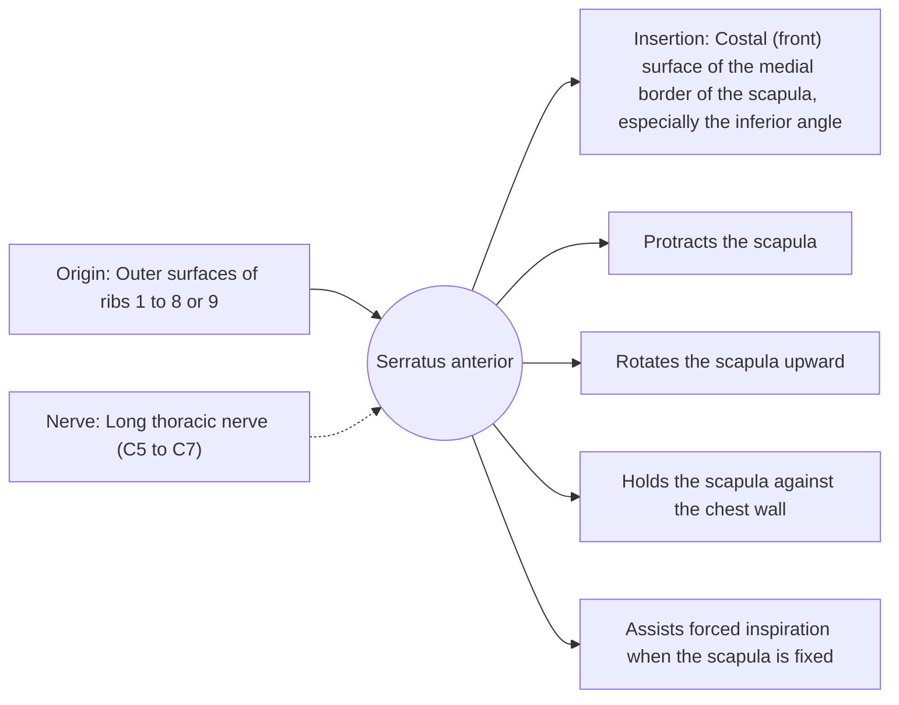

# Serratus anterior

## Summary

The serratus anterior wraps around the side of the rib cage from the ribs to the inner border of the shoulder blade. It pulls the scapula forward around the chest (protraction), rotates it upward and holds it flat against the ribs. Its jagged edge gives it its name ("saw-toothed") and it is often called the "boxer's muscle".

## Prerequisites

- [Muscular system overview](../muscular-system-overview.md)

## Core concepts

### Definition

The *serratus anterior* is a broad, flat muscle on the lateral chest wall, arising with eight or nine slips from the upper ribs.

### Analogy

The serratus anterior is like the hand holding a playing card flat against a ball: it keeps the card (scapula) from lifting off while sliding it around. The analogy breaks because the "hand" also rotates the card upward to point the shoulder socket toward the ceiling.

### Mechanism

The lower fibers, attached to the inferior angle, are the strongest upward rotators. Weakness or nerve injury causes scapular winging.

The diagram shows the attachments, the nerve and the actions.

### Attachments and innervation

| Feature | Description |
| --- | --- |
| Latin name | *musculus serratus anterior* |
| Origin | Outer surfaces of ribs 1 to 8 or 9 |
| Insertion | Costal (front) surface of the medial border of the scapula, especially the inferior angle |
| Innervation | Long thoracic nerve (C5 to C7) |
| Actions | Protracts the scapula; Rotates the scapula upward; Holds the scapula against the chest wall; Assists forced inspiration when the scapula is fixed |

### Exercises and tests

Push-ups with a plus (extra protraction at the top), wall slides, punches with a cable, overhead presses.

## Worked example

In a push-up, the serratus anterior keeps the scapulae flat on the ribs. If it is weak, the inner borders of the shoulder blades lift visibly at the bottom of the movement. Adding a "plus" at the top, pushing the chest away from the floor, emphasizes this muscle.

## Trade offs and when to use it

Critical for healthy overhead movement; its long nerve on the outside of the chest wall is vulnerable during surgery and heavy backpack carrying.

## Common mistakes

- **Ignoring winging when training overhead.** Weak serratus anterior is linked to shoulder impingement; strengthen it before heavy overhead work.

## Practice

1. Which nerve supplies the serratus anterior?
2. What is the sign of serratus anterior weakness?

### Answers

1. The long thoracic nerve.
2. Scapular winging.

## Further reading

- Standring, S. (Ed.) (2020). *Gray's Anatomy: The Anatomical Basis of Clinical Practice (42nd ed.)*. Elsevier. Reference text for attachments, innervation and relations.
- Betts, J. G., Young, K. A., Wise, J. A. et al. (2022). *Anatomy and Physiology 2e*. OpenStax, Rice University. [Link](https://openstax.org/details/books/anatomy-and-physiology-2e). Open textbook with illustrations of the skeletal and muscular systems.
