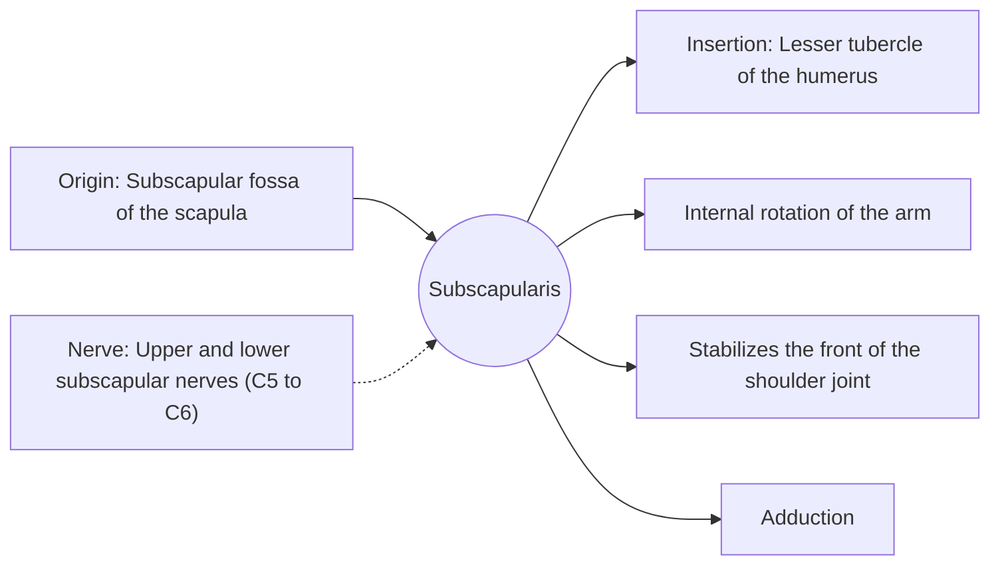

# Subscapularis

## Summary

The subscapularis is the largest rotator cuff muscle, on the front surface of the scapula facing the ribs. It rotates the arm inward and protects the front of the shoulder joint against dislocation.

## Prerequisites

- [Muscular system overview](../muscular-system-overview.md)

## Core concepts

### Definition

The *subscapularis* fills the subscapular fossa and inserts on the lesser tubercle, the only rotator cuff muscle on the front of the humerus.

### Analogy

The subscapularis is like a strong front door holding the humeral head back from slipping forward. The analogy breaks because the door also turns the arm inward.

### Mechanism

It is the main dynamic stabilizer against anterior dislocation, especially with the arm at the side and in lower ranges of abduction.

The diagram shows the attachments, the nerve and the actions.

### Attachments and innervation

| Feature | Description |
| --- | --- |
| Latin name | *musculus subscapularis* |
| Origin | Subscapular fossa of the scapula |
| Insertion | Lesser tubercle of the humerus |
| Innervation | Upper and lower subscapular nerves (C5 to C6) |
| Actions | Internal rotation of the arm; Stabilizes the front of the shoulder joint; Adduction |

### Exercises and tests

Internal rotation with bands or cables, push-ups, presses.

## Worked example

The "lift-off test" checks the subscapularis: the patient places the back of the hand on the lower back and tries to lift it away. Inability to do so suggests a subscapularis tear.

## Trade offs and when to use it

The strongest cuff muscle; weakness predisposes to anterior instability.

## Common mistakes

- **Neglecting it because it cannot be seen.** It is a key front stabilizer of the shoulder.

## Practice

1. Where does the subscapularis insert?
2. Which test checks the subscapularis?

### Answers

1. On the lesser tubercle of the humerus.
2. The lift-off test (or belly press test).

## Further reading

- Standring, S. (Ed.) (2020). *Gray's Anatomy: The Anatomical Basis of Clinical Practice (42nd ed.)*. Elsevier. Reference text for attachments, innervation and relations.
- Betts, J. G., Young, K. A., Wise, J. A. et al. (2022). *Anatomy and Physiology 2e*. OpenStax, Rice University. [Link](https://openstax.org/details/books/anatomy-and-physiology-2e). Open textbook with illustrations of the skeletal and muscular systems.
