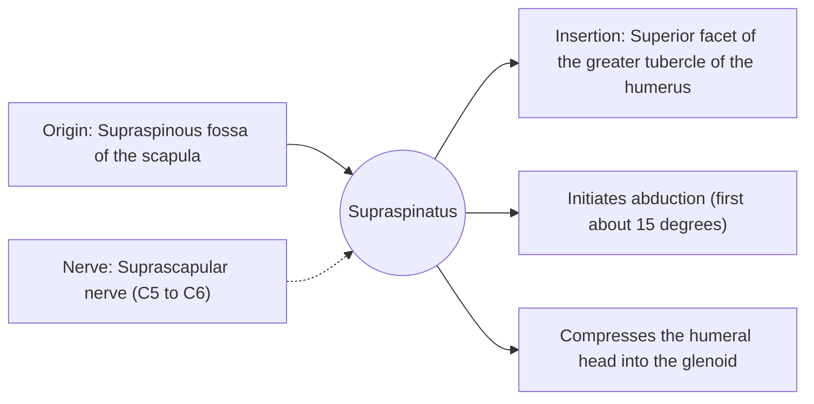

# Supraspinatus

## Summary

The supraspinatus is the rotator cuff muscle above the spine of the scapula. It starts abduction of the arm and presses the humeral head into the socket. Its tendon runs under the acromion and is the most commonly injured rotator cuff tendon.

## Prerequisites

- [Muscular system overview](../muscular-system-overview.md)

## Core concepts

### Definition

The *supraspinatus* fills the supraspinous fossa of the scapula and runs under the acromion to the top of the greater tubercle.

### Analogy

The supraspinatus is like the first pull on a heavy door, which gets it moving before the bigger push (deltoid) takes over. The analogy breaks because it keeps working throughout abduction to hold the head in place.

### Mechanism

It works with the deltoid throughout abduction. The tendon passes through the narrow subacromial space, where it can be irritated or degenerate.

The diagram shows the attachments, the nerve and the actions.

### Attachments and innervation

| Feature | Description |
| --- | --- |
| Latin name | *musculus supraspinatus* |
| Origin | Supraspinous fossa of the scapula |
| Insertion | Superior facet of the greater tubercle of the humerus |
| Innervation | Suprascapular nerve (C5 to C6) |
| Actions | Initiates abduction (first about 15 degrees); Compresses the humeral head into the glenoid |

### Exercises and tests

Scaption with light weights, "empty can" and "full can" raises, band abduction.

## Worked example

The "painful arc", pain between about 60 and 120 degrees of arm abduction, is typical of supraspinatus tendon irritation, because the tendon is closest to the acromion in this range.

## Trade offs and when to use it

Small but critical; its tendon has a zone of poor blood supply near the insertion.

## Common mistakes

- **Testing it with heavy loads.** It is a small muscle; light loads and controlled tempo suit it.

## Practice

1. Where does the supraspinatus insert?
2. What is a painful arc?

### Answers

1. On the superior facet of the greater tubercle.
2. Pain during the middle range of abduction, typical of supraspinatus problems.

## Further reading

- Standring, S. (Ed.) (2020). *Gray's Anatomy: The Anatomical Basis of Clinical Practice (42nd ed.)*. Elsevier. Reference text for attachments, innervation and relations.
- Betts, J. G., Young, K. A., Wise, J. A. et al. (2022). *Anatomy and Physiology 2e*. OpenStax, Rice University. [Link](https://openstax.org/details/books/anatomy-and-physiology-2e). Open textbook with illustrations of the skeletal and muscular systems.
