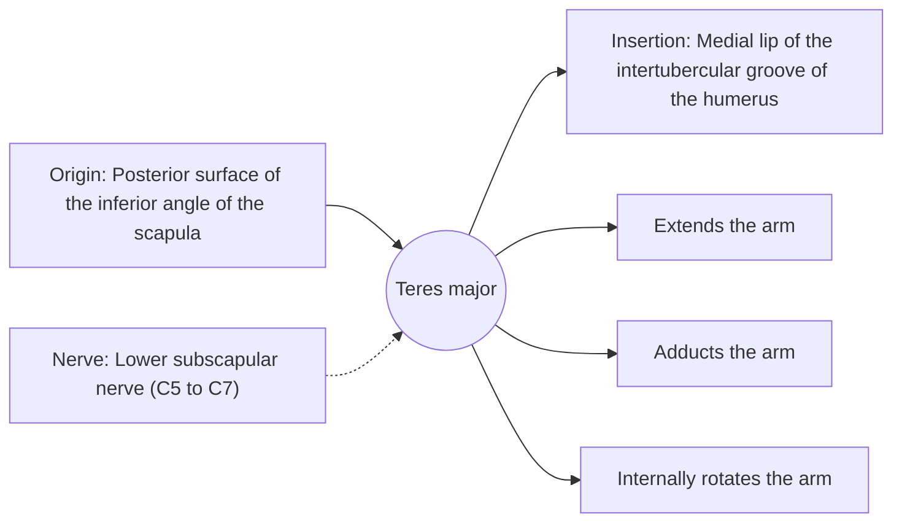

# Teres major

## Summary

The teres major is a thick muscle running from the lower angle of the scapula to the front of the humerus. It extends, adducts and internally rotates the arm, working as the "little helper" of the latissimus dorsi. It is not part of the rotator cuff.

## Prerequisites

- [Muscular system overview](../muscular-system-overview.md)

## Core concepts

### Definition

The *teres major* lies below the teres minor and inserts next to the latissimus dorsi on the humerus.

### Analogy

The teres major is like a short second rope beside the latissimus, pulling the arm down and back from the shoulder blade instead of the spine. The analogy breaks because it acts only when the scapula is stabilized by the rhomboids.

### Mechanism

It forms the lower border of the quadrangular and triangular spaces of the shoulder.

The diagram shows the attachments, the nerve and the actions.

### Attachments and innervation

| Feature | Description |
| --- | --- |
| Latin name | *musculus teres major* |
| Origin | Posterior surface of the inferior angle of the scapula |
| Insertion | Medial lip of the intertubercular groove of the humerus |
| Innervation | Lower subscapular nerve (C5 to C7) |
| Actions | Extends the arm; Adducts the arm; Internally rotates the arm |

### Exercises and tests

Rows, pull-downs, pull-ups (with the latissimus).

## Worked example

In a straight-arm pulldown, the teres major and latissimus together pull the arm from overhead to the hips; the teres major can be felt at the lower outer border of the scapula.

## Trade offs and when to use it

Supports the latissimus in pulling; limits overhead reach when stiff.

## Common mistakes

- **Calling it a rotator cuff muscle.** It inserts on the humerus away from the joint capsule and is not part of the cuff.

## Practice

1. Which muscle does the teres major assist?
2. Is it part of the rotator cuff?

### Answers

1. The latissimus dorsi.
2. No.

## Further reading

- Standring, S. (Ed.) (2020). *Gray's Anatomy: The Anatomical Basis of Clinical Practice (42nd ed.)*. Elsevier. Reference text for attachments, innervation and relations.
- Betts, J. G., Young, K. A., Wise, J. A. et al. (2022). *Anatomy and Physiology 2e*. OpenStax, Rice University. [Link](https://openstax.org/details/books/anatomy-and-physiology-2e). Open textbook with illustrations of the skeletal and muscular systems.
