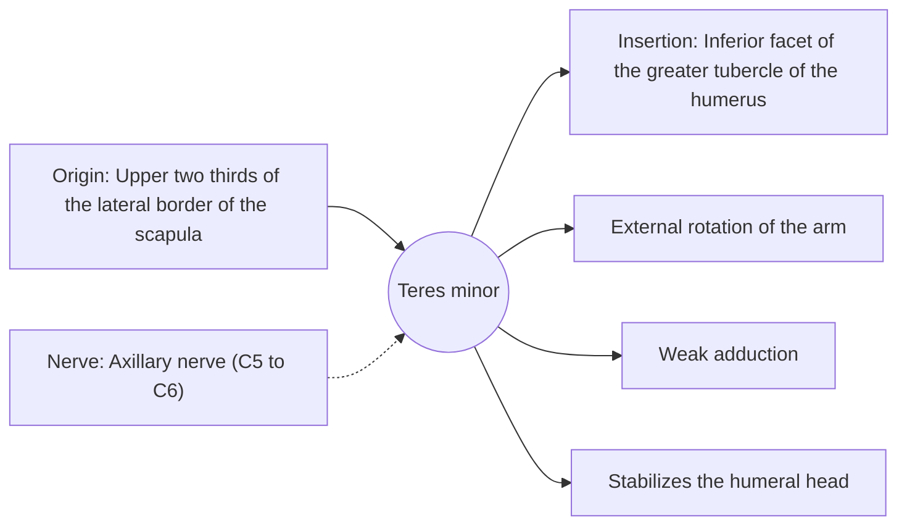

# Teres minor

## Summary

The teres minor is a small, narrow rotator cuff muscle along the lower outer border of the scapula. It rotates the arm outward together with the infraspinatus and steadies the humeral head.

## Prerequisites

- [Muscular system overview](../muscular-system-overview.md)

## Core concepts

### Definition

The *teres minor* lies just below the infraspinatus and above the teres major.

### Analogy

The teres minor is like a smaller helper beside the infraspinatus on the same doorknob. The analogy breaks because it has a different nerve (axillary), which matters in nerve injuries.

### Mechanism

It works with the infraspinatus; in large rotator cuff tears involving the infraspinatus, the teres minor may become important for remaining external rotation.

The diagram shows the attachments, the nerve and the actions.

### Attachments and innervation

| Feature | Description |
| --- | --- |
| Latin name | *musculus teres minor* |
| Origin | Upper two thirds of the lateral border of the scapula |
| Insertion | Inferior facet of the greater tubercle of the humerus |
| Innervation | Axillary nerve (C5 to C6) |
| Actions | External rotation of the arm; Weak adduction; Stabilizes the humeral head |

### Exercises and tests

The same external rotation exercises as the infraspinatus.

## Worked example

The teres minor forms part of the borders of the quadrangular space, through which the axillary nerve and posterior circumflex humeral artery pass. Compression there, seen in some throwing athletes, causes shoulder pain and weakness.

## Trade offs and when to use it

Small but meaningful when the infraspinatus is torn.

## Common mistakes

- **Confusing teres minor with teres major.** Teres minor rotates the arm outward and belongs to the rotator cuff; teres major rotates it inward and does not.

## Practice

1. Which nerve supplies the teres minor?
2. Is the teres minor part of the rotator cuff?

### Answers

1. The axillary nerve.
2. Yes.

## Further reading

- Standring, S. (Ed.) (2020). *Gray's Anatomy: The Anatomical Basis of Clinical Practice (42nd ed.)*. Elsevier. Reference text for attachments, innervation and relations.
- Betts, J. G., Young, K. A., Wise, J. A. et al. (2022). *Anatomy and Physiology 2e*. OpenStax, Rice University. [Link](https://openstax.org/details/books/anatomy-and-physiology-2e). Open textbook with illustrations of the skeletal and muscular systems.
