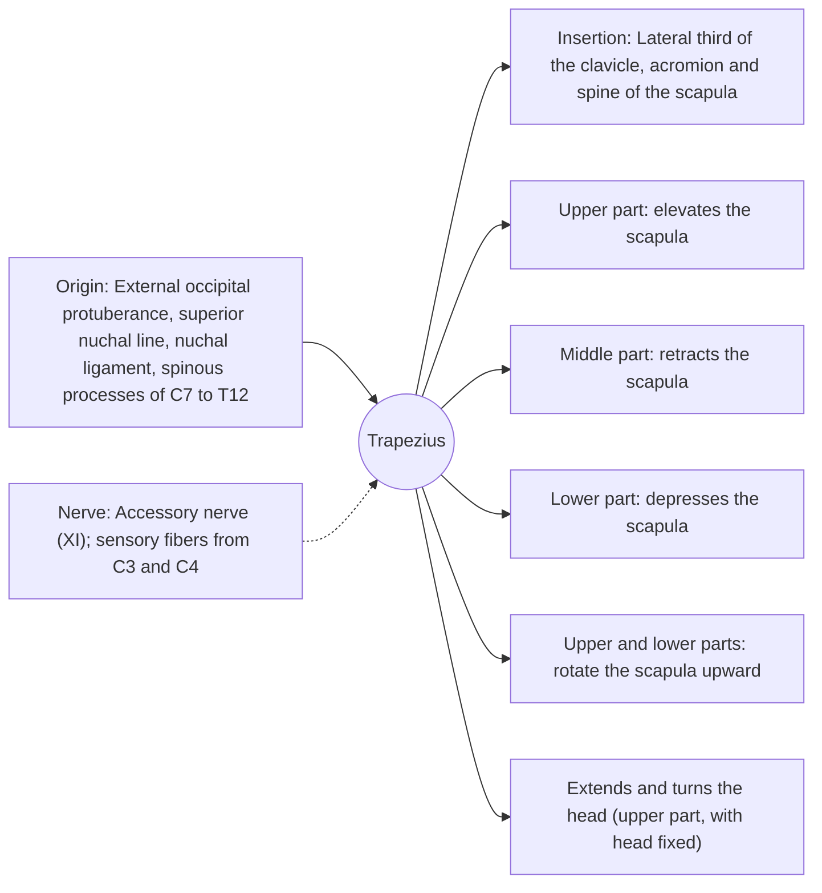

# Trapezius

## Summary

The trapezius is a large, flat, diamond-shaped muscle (together with its partner) covering the upper back and the back of the neck. Its upper, middle and lower parts move the shoulder blade in different directions: elevation, retraction and depression, and together they rotate it upward when the arm is raised. It forms the slope from the neck to the shoulder.

## Prerequisites

- [Muscular system overview](../muscular-system-overview.md)

## Core concepts

### Definition

The *trapezius* is a superficial back muscle with descending (upper), transverse (middle) and ascending (lower) parts.

### Analogy

The trapezius is like three ropes attached to a sled (the scapula) from above, from the side and from below. Pulling each rope moves the sled in a different direction, and pulling the upper and lower ropes together turns it. The analogy breaks because the sled sits on a curved surface (the rib cage) and must stay against it.

### Mechanism

Upward rotation of the scapula by the upper and lower trapezius together with the serratus anterior is essential for raising the arm above shoulder height.

The diagram shows the attachments, the nerve and the actions.

### Attachments and innervation

| Feature | Description |
| --- | --- |
| Latin name | *musculus trapezius* |
| Origin | External occipital protuberance, superior nuchal line, nuchal ligament, spinous processes of C7 to T12 |
| Insertion | Lateral third of the clavicle, acromion and spine of the scapula |
| Innervation | Accessory nerve (XI); sensory fibers from C3 and C4 |
| Actions | Upper part: elevates the scapula; Middle part: retracts the scapula; Lower part: depresses the scapula; Upper and lower parts: rotate the scapula upward; Extends and turns the head (upper part, with head fixed) |

### Self-relaxation of the trapezius

Tension in the upper trapezius is common with stress and desk work. Relaxation techniques are described in [Trapezius self-relaxation](../../../physiotherapy/trapezius-self-relaxation.md).

### Exercises and tests

Shrugs (upper part), rows with scapular retraction (middle part), Y-raises and prone lower trapezius raises (lower part), overhead presses.

## Worked example

Injury to the accessory nerve during lymph node surgery in the lateral neck causes a drooping shoulder and difficulty raising the arm above the head, because the trapezius can no longer rotate the scapula upward.

## Trade offs and when to use it

Large, versatile, and often overactive in its upper part while the lower part is underused, a pattern targeted by corrective exercise.

## Common mistakes

- **Training only shrugs.** The middle and lower parts need rows and raises.

## Practice

1. Which nerve supplies the trapezius?
2. Which parts of the trapezius rotate the scapula upward?

### Answers

1. The accessory nerve (XI).
2. The upper and lower parts, with the serratus anterior.

## Further reading

- Standring, S. (Ed.) (2020). *Gray's Anatomy: The Anatomical Basis of Clinical Practice (42nd ed.)*. Elsevier. Reference text for attachments, innervation and relations.
- Betts, J. G., Young, K. A., Wise, J. A. et al. (2022). *Anatomy and Physiology 2e*. OpenStax, Rice University. [Link](https://openstax.org/details/books/anatomy-and-physiology-2e). Open textbook with illustrations of the skeletal and muscular systems.
