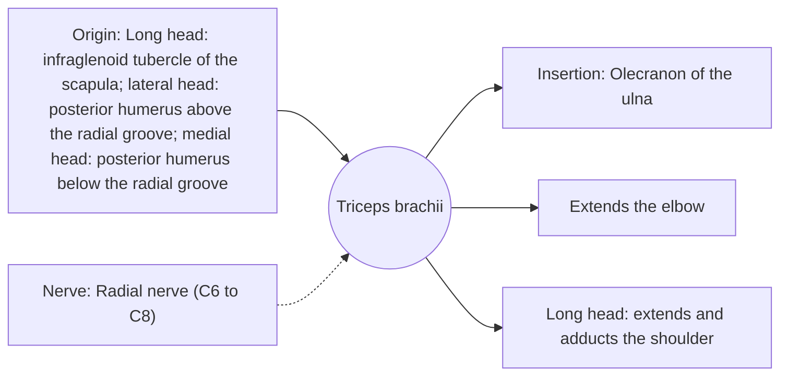

# Triceps brachii

## Summary

The triceps brachii is the three-headed muscle at the back of the upper arm and the only major elbow extensor. Its long head also crosses the shoulder and helps extend and adduct the arm. It makes up about two thirds of the arm's muscle mass.

## Prerequisites

- [Muscular system overview](../muscular-system-overview.md)

## Core concepts

### Definition

The *triceps brachii* has long, lateral and medial heads converging on a common tendon to the olecranon.

### Analogy

The triceps is the antagonist of the biceps: like the rope on the other side of a seesaw, it straightens the arm when the biceps relaxes. The analogy breaks because the triceps also has a part that crosses the shoulder.

### Mechanism

The medial head is active in all elbow extension; the lateral and long heads join under heavier load. Overhead extensions stretch the long head at the shoulder, which may favor its growth.

The diagram shows the attachments, the nerve and the actions.

### Attachments and innervation

| Feature | Description |
| --- | --- |
| Latin name | *musculus triceps brachii* |
| Origin | Long head: infraglenoid tubercle of the scapula; lateral head: posterior humerus above the radial groove; medial head: posterior humerus below the radial groove |
| Insertion | Olecranon of the ulna |
| Innervation | Radial nerve (C6 to C8) |
| Actions | Extends the elbow; Long head: extends and adducts the shoulder |

### Exercises and tests

Close-grip bench press, dips, push-ups, overhead extensions, pushdowns.

## Worked example

In a push-up, the triceps extends the elbow while the pectoralis major and anterior deltoid move the shoulder. Narrowing the hand position increases the triceps share of the work.

## Trade offs and when to use it

Large and strong; the long head links arm and shoulder function.

## Common mistakes

- **Training the triceps only with pushdowns.** Overhead work loads the long head in a stretched position.

## Practice

1. Which nerve supplies the triceps?
2. Which head crosses the shoulder?

### Answers

1. The radial nerve.
2. The long head.

## Further reading

- Standring, S. (Ed.) (2020). *Gray's Anatomy: The Anatomical Basis of Clinical Practice (42nd ed.)*. Elsevier. Reference text for attachments, innervation and relations.
- Betts, J. G., Young, K. A., Wise, J. A. et al. (2022). *Anatomy and Physiology 2e*. OpenStax, Rice University. [Link](https://openstax.org/details/books/anatomy-and-physiology-2e). Open textbook with illustrations of the skeletal and muscular systems.
