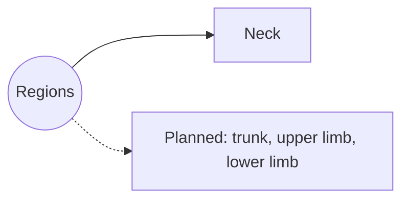

# Body regions

Regional anatomy describes everything found in one part of the body together: surface landmarks, bones, muscles, vessels and nerves. The systematic notes (skeleton, joints, muscles) describe each structure alone; regional notes show how they are arranged next to each other.

## Map

## Notes

1. [Neck](neck.md): surface anatomy, layers and triangles of the neck.

## Planned topics

- Trunk
- Upper limb
- Lower limb
