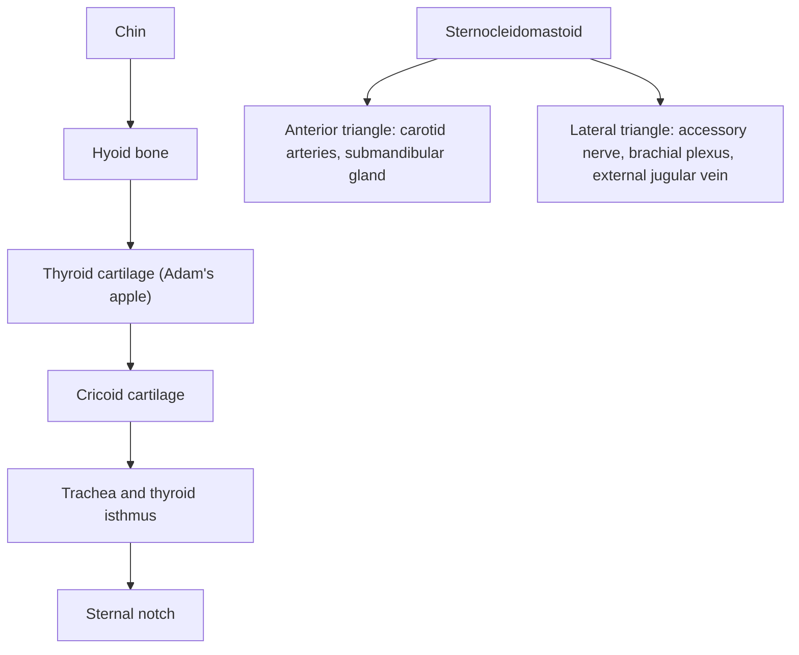

# Neck

## Summary

The neck connects the head to the trunk. Its front part is the neck proper and its back part the nape. It holds the airway, the start of the digestive tract, the thyroid gland, the great vessels to the head and the nerves to the arms. Landmarks that can be felt in the midline, from top to bottom, are the hyoid bone, the thyroid cartilage (Adam's apple), the cricoid cartilage, and between it and the sternal notch the trachea and the isthmus of the thyroid gland. The sternocleidomastoid divides each side into an anterior and a lateral triangle.

## Prerequisites

- [Directional terms](../anatomical-terminology/directional-terms.md)

## Core concepts

### Definition

The *neck* (*collum*, *cervix*) is the part of the body between the head and the trunk. Its upper boundary is the lower border of the mandible and the base of the skull; its lower boundary is the sternal notch, the clavicles and the line to the spinous process of C7. The front is the neck proper (*regio cervicalis anterior*); the back is the nape (*nucha*). The lower boundary of the neck at the side is the clavicle, and the sloping contour of the side of the neck comes from the trapezius.

### Analogy

The neck is like a busy service tunnel between two buildings: it carries the air duct (trachea), the supply pipe (esophagus), main power lines (carotid arteries, jugular veins, vagus nerve) and data cables (the brachial plexus, the spinal cord), all wrapped in layers of insulation (fascia) and supported by a flexible frame (the cervical spine and muscles). The analogy breaks because the tunnel also bends and twists constantly.

### Mechanism

**Midline landmarks** (top to bottom):

1. **Hyoid bone**: felt in the midline below the chin ([Hyoid bone](../skeletal-system/skull/hyoid-bone.md)).
2. **Thyroid cartilage**: its prominence (Adam's apple) is more visible in men than in women.
3. **Cricoid cartilage**: a ring below the thyroid cartilage; the cricothyroid membrane between them is the site for emergency airway access.
4. **Trachea and thyroid isthmus**: between the cricoid and the sternal notch, the trachea and the isthmus of the thyroid gland may bulge.
5. **Jugular (sternal) notch**: the upper edge of the manubrium.

**Lateral landmarks.**

- The **sternocleidomastoid** is the most visible feature of the side of the neck. It separates the *anterior triangle* in front from the *lateral (posterior) triangle* behind ([Sternocleidomastoid](../muscular-system/head-and-neck/sternocleidomastoid.md)).
- In the upper part of the anterior triangle, the **submandibular salivary gland** lies below the back half of the body of the mandible.
- The course of the **internal and external carotid arteries** can be traced by extending the line of the front edge of the sternocleidomastoid up to the angle of the mandible. The carotid pulse is felt at the level of the thyroid cartilage, in front of the muscle.
- The **accessory nerve** (XI) crosses the lateral triangle along a line from a point halfway between the angle of the mandible and the mastoid process to the middle of the back edge of the sternocleidomastoid.
- The **external jugular vein** can usually be seen through the skin, running from the angle of the mandible to the middle of the clavicle, crossing the sternocleidomastoid. Numerous lymph nodes accompany it on both sides.
- The **trapezius** forms the sloping outline from the neck to the shoulder.

**Layers of muscles.** Superficial (platysma, sternocleidomastoid, trapezius), middle (infrahyoid and suprahyoid groups around the hyoid), deep (scalenes and prevertebral muscles). See [Head and neck muscles](../muscular-system/head-and-neck/README.md).

The diagram shows the main midline landmarks and the triangles.

## Worked example

In an emergency where a person cannot breathe because of an obstruction above the larynx and intubation fails, a clinician can open the airway through the cricothyroid membrane. Finding it uses the landmarks above: slide a finger down from the thyroid prominence to the soft gap just above the ring of the cricoid cartilage. This procedure (cricothyrotomy) is a last resort performed by trained professionals.

## Trade offs and when to use it

- Surface landmarks are reliable in thin necks and harder to find with obesity or swelling, which is why ultrasound is increasingly used to locate structures.

## Common mistakes

- **Taking the carotid pulse with too much pressure or on both sides at once.** This can slow the heart or reduce blood flow to the brain; feel one side gently.
- **Confusing the thyroid gland with the thyroid cartilage.** The gland lies below and around the cartilage, on the trachea.

## Practice

1. List the midline landmarks of the neck from top to bottom.
2. What divides the side of the neck into two triangles?
3. Where is the external jugular vein usually visible?

### Answers

1. Hyoid bone, thyroid cartilage, cricoid cartilage, trachea with the thyroid isthmus, sternal notch.
2. The sternocleidomastoid.
3. On a line from the angle of the mandible to the middle of the clavicle, crossing the sternocleidomastoid.

## Further reading

- Standring, S. (Ed.) (2020). *Gray's Anatomy: The Anatomical Basis of Clinical Practice (42nd ed.)*. Elsevier. Reference text for attachments, innervation and relations.
- Betts, J. G., Young, K. A., Wise, J. A. et al. (2022). *Anatomy and Physiology 2e*. OpenStax, Rice University. [Link](https://openstax.org/details/books/anatomy-and-physiology-2e). Open textbook with illustrations of the skeletal and muscular systems.
