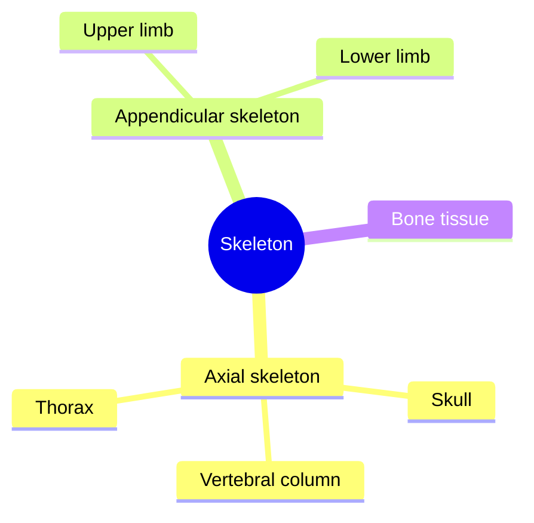

# Skeletal system

The skeleton is the frame of the body: about 206 bones in an adult, joined by joints and moved by muscles. These notes start with bone as a tissue and the layout of the whole skeleton, then describe each region and each major bone.

## Map

## Reading order

1. [Skeletal system overview](skeletal-system-overview.md): the parts of the skeleton, bone shapes and functions.
2. [Bone tissue](bone-tissue.md): bone cells, structure, remodeling and nutrition for bone.
3. [Skull](skull/README.md): the neurocranium and viscerocranium, one note per bone.
4. [Vertebral column](vertebral-column/README.md): the regions, special vertebrae and discs.
5. [Thorax](thorax/README.md): sternum and ribs.
6. [Upper limb bones](upper-limb/README.md): from clavicle to fingers.
7. [Lower limb bones](lower-limb/README.md): from hip bone to toes.
