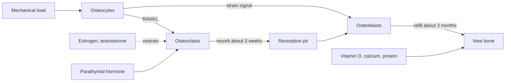

# Bone tissue

## Summary

Bone is a living connective tissue made of cells in a matrix of collagen fibers and calcium phosphate crystals. Collagen gives flexibility and the mineral gives hardness. Osteoblasts build bone, osteoclasts break it down and osteocytes sense load and coordinate the two. About 10 percent of the adult skeleton is replaced every year. Load, hormones and nutrients such as calcium, vitamin D, protein and vitamin K decide whether bone mass is gained or lost.

## Prerequisites

- [Skeletal system overview](skeletal-system-overview.md)
- [Tissues](../../../../natural-sciences/biology/cell-biology/tissues.md)

## Core concepts

### Definition

*Bone tissue* (osseous tissue) is a hard connective tissue whose matrix is about 60 percent mineral (mainly hydroxyapatite, a calcium phosphate), 30 percent organic (90 percent of it type I collagen) and 10 percent water by weight. *Compact (cortical) bone* is dense and forms the outer shell; *spongy (trabecular, cancellous) bone* is a lattice of thin struts (trabeculae) inside the ends of long bones and in vertebrae.

### Analogy

Bone is like reinforced concrete: collagen is the steel rebar that resists bending and pulling, and hydroxyapatite is the concrete that resists compression. Concrete without rebar cracks; rebar without concrete bends. In brittle bone disease (osteogenesis imperfecta) the "rebar" is faulty, and in rickets and osteomalacia the "concrete" is missing. The analogy breaks because bone is constantly demolished and rebuilt by its own cells, in response to the loads it feels.

### Mechanism

**Cells.**

| Cell | Origin | Role |
| --- | --- | --- |
| Osteoblast | Mesenchymal stem cells | Lays down collagen and mineralizes it |
| Osteocyte | Osteoblast trapped in matrix | Senses strain, signals to the other cells (sclerostin, RANKL) |
| Osteoclast | Fused monocyte-macrophage cells | Dissolves mineral with acid and digests collagen |

**Remodeling.** In small units, osteoclasts resorb a pit over about 3 weeks, then osteoblasts refill it over about 3 months. Mechanical loading reduces sclerostin from osteocytes, which allows more bone formation where strain is high (Wolff's law, the idea that bone adapts to the loads placed on it).

**Hormones.** Parathyroid hormone raises blood calcium by increasing resorption; calcitriol (active vitamin D) increases calcium absorption from the gut; estrogen and testosterone restrain osteoclasts, which is why bone loss speeds up after menopause; calcitonin has a minor role in adults.

**Growth.** Long bones grow in length at the growth plates (epiphyseal plates) of cartilage, which close after puberty. Bone mass peaks in the late twenties to early thirties.

The diagram shows the remodeling cycle and what controls it.

### Nutrition for bone

Calcium (adults about 950 to 1,000 mg per day), vitamin D, protein, vitamin K (for osteocalcin), magnesium and phosphorus all contribute. Collagen production also needs vitamin C. Details are in the nutrition notes: [Calcium](../../nutrition/minerals/calcium.md), [Vitamin D](../../nutrition/vitamins/vitamin-d.md) and [Vitamin K2](../../nutrition/vitamins/vitamin-k2.md).

## Worked example

Bone density is measured by dual-energy X-ray absorptiometry (DXA) and reported as a T-score, the number of standard deviations from the mean of young healthy adults of the same sex. The World Health Organization defines osteoporosis as a T-score of -2.5 or lower and osteopenia as between -1.0 and -2.5. A 65-year-old woman with a hip T-score of -2.7 meets the definition of osteoporosis and has a several times higher risk of hip fracture than a woman with normal density; treatment decisions also consider other risk factors, often with the FRAX calculator.

## Trade offs and when to use it

- High-impact and resistance exercise build and maintain bone; swimming and cycling do little for bone density, although they have other benefits.
- Very low energy intake, especially with missed periods in athletes (relative energy deficiency in sport), causes bone loss and stress fractures.

## Common mistakes

- **Relying on calcium alone.** Load, vitamin D, protein and hormones matter as much.
- **Thinking adult bone cannot change.** Remodeling continues, and training can increase density modestly in adults.

## Practice

1. Which cell type breaks down bone?
2. What does a T-score of -2.5 mean?
3. Why does bone loss accelerate after menopause?

### Answers

1. Osteoclasts.
2. Bone density 2.5 standard deviations below the young adult mean, the threshold for osteoporosis.
3. Estrogen falls, and estrogen normally restrains osteoclast activity.

## Further reading

- Standring, S. (Ed.) (2020). *Gray's Anatomy: The Anatomical Basis of Clinical Practice (42nd ed.)*. Elsevier. Reference text for attachments, innervation and relations.
- Betts, J. G., Young, K. A., Wise, J. A. et al. (2022). *Anatomy and Physiology 2e*. OpenStax, Rice University. [Link](https://openstax.org/details/books/anatomy-and-physiology-2e). Open textbook with illustrations of the skeletal and muscular systems.
- NIH Office of Dietary Supplements. Calcium: Fact Sheet for Health Professionals. [Link](https://ods.od.nih.gov/factsheets/Calcium-HealthProfessional/). Calcium intake and bone health.
