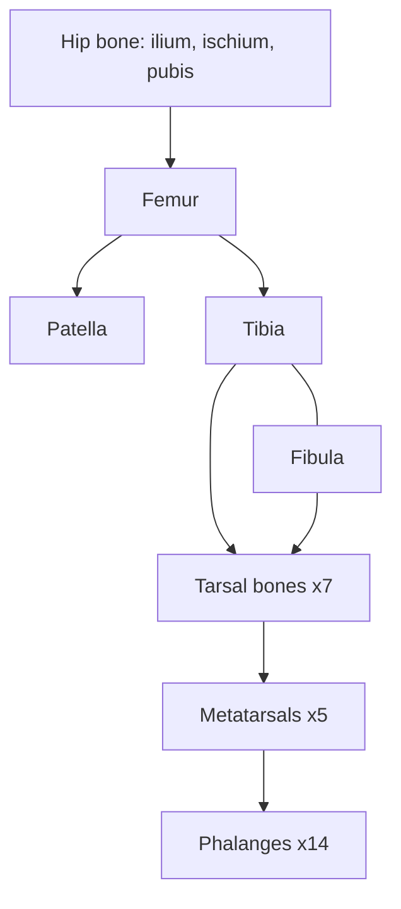

# Lower limb bones

The lower limb is built for weight bearing and walking. Each side has the hip bone (part of the pelvic girdle), the femur, the patella, the tibia and fibula, 7 tarsal bones, 5 metatarsals and 14 phalanges.

## Map

## Reading order

1. [Hip bone and pelvis](hip-bone.md): the pelvic bone and the pelvis as a whole.
2. [Femur](femur.md)
3. [Patella](patella.md)
4. [Tibia](tibia.md)
5. [Fibula](fibula.md)
6. [Tarsal bones](tarsal-bones.md)
7. [Metatarsals and phalanges of the foot](foot-bones.md): metatarsals and phalanges.
