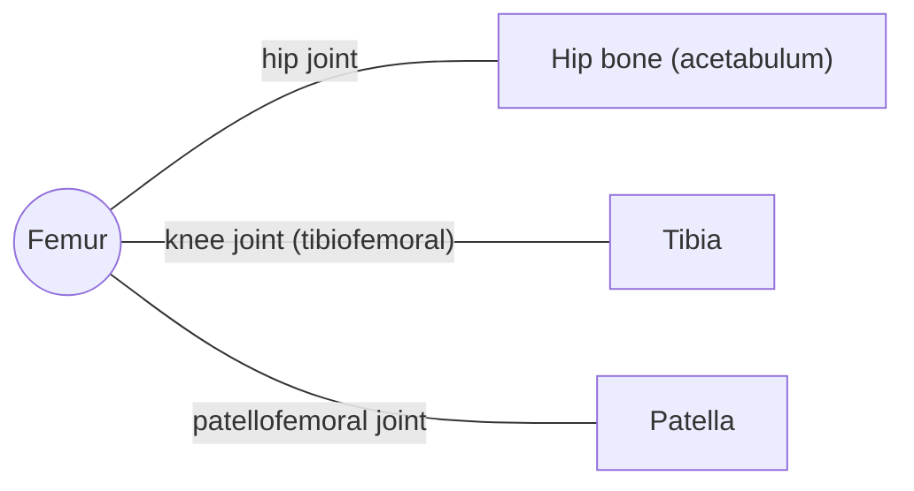

# Femur

## Summary

The femur (thigh bone) is the longest and strongest bone of the body, about a quarter of body height. Its head forms the hip joint, its neck angles out to the shaft, and its lower end forms the knee with the tibia and patella. Hip fractures, usually of the femoral neck, are a serious injury in older adults.

## Prerequisites

- [Skeletal system overview](../skeletal-system-overview.md)

## Core concepts

### Definition

The *femur* is a paired long bone with a proximal end (head, neck, greater and lesser trochanters), a shaft and a distal end with two condyles. Latin: *femur*.

### Analogy

The femur is like the long arm of a crane with an angled jib at the top: the neck holds the head away from the shaft so the leg can swing clear of the pelvis. The angle gives clearance but creates a bending load on the neck. The analogy breaks because bone reinforces itself along the lines of stress (trabecular patterns in the neck).

### Mechanism

The neck-shaft angle is about 125 degrees in adults. The greater trochanter receives the gluteus medius and minimus, which stabilize the pelvis when standing on one leg; the lesser trochanter receives the iliopsoas. The linea aspera on the back of the shaft anchors the adductors and the vasti.

The diagram shows the bones this bone meets and the joints it forms.

### Landmarks

| Landmark | Description |
| --- | --- |
| Head | Hip joint; ligament of the head carries a small artery |
| Neck | Angled about 125 degrees; common fracture site |
| Greater trochanter | Gluteus medius and minimus, piriformis, obturators |
| Lesser trochanter | Iliopsoas |
| Gluteal tuberosity | Gluteus maximus |
| Linea aspera | Adductors and vastus lateralis and medialis |
| Medial and lateral condyles | Knee joint |
| Patellar surface | Groove for the kneecap |
| Medial and lateral epicondyles | Collateral ligaments, gastrocnemius |

### Muscle attachments

Gluteus maximus, medius and minimus, iliopsoas, piriformis and deep external rotators, adductor group, quadriceps (vasti), short head of biceps femoris, gastrocnemius, popliteus, plantaris.

## Worked example

A femoral neck fracture after a fall in an older person causes a shortened, externally rotated leg and inability to stand. About one in five older people dies within a year after a hip fracture, largely due to complications of immobility, which is why surgery is usually done within 24 to 48 hours.

## Trade offs and when to use it

The angled neck gives the leg range of motion but concentrates bending stress where bone weakens most with osteoporosis.

## Common mistakes

- **Saying the femur is the strongest bone because it is the thickest.** Its strength comes from its tubular cortex and trabecular architecture, not only its size.

## Practice

1. Which muscle inserts on the lesser trochanter?
2. What is the typical neck-shaft angle of the femur?

### Answers

1. Iliopsoas.
2. About 125 degrees.

## Further reading

- Standring, S. (Ed.) (2020). *Gray's Anatomy: The Anatomical Basis of Clinical Practice (42nd ed.)*. Elsevier. Reference text for attachments, innervation and relations.
- Betts, J. G., Young, K. A., Wise, J. A. et al. (2022). *Anatomy and Physiology 2e*. OpenStax, Rice University. [Link](https://openstax.org/details/books/anatomy-and-physiology-2e). Open textbook with illustrations of the skeletal and muscular systems.
