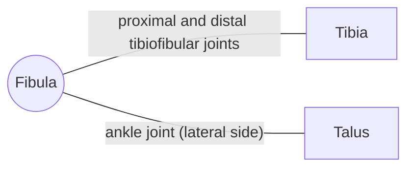

# Fibula

## Summary

The fibula is the thin bone on the outer side of the lower leg. It carries little body weight (about 10 to 15 percent) but anchors muscles and forms the outer ankle bone (lateral malleolus), which stabilizes the ankle joint. The common fibular nerve winds around its neck, just below the knee.

## Prerequisites

- [Skeletal system overview](../skeletal-system-overview.md)

## Core concepts

### Definition

The *fibula* is a paired, slender long bone lateral to the tibia, with a head, neck, shaft and a distal lateral malleolus. Latin: *fibula*.

### Analogy

The fibula is like a tent pole beside the main mast: it carries little load but holds the canvas (muscles) and stakes the corner (lateral ankle). The analogy breaks because removing a segment of the fibula is possible in surgery (for bone grafts) with little effect on walking, which would not be true of most structural poles.

### Mechanism

The lateral malleolus extends lower than the medial malleolus and forms the outer wall of the ankle mortise. The interosseous membrane links the fibula to the tibia. The common fibular nerve, which lifts the foot, is at risk around the fibular neck.

The diagram shows the bones this bone meets and the joints it forms.

### Landmarks

| Landmark | Description |
| --- | --- |
| Head | Biceps femoris tendon and lateral collateral ligament attach |
| Neck | Common fibular nerve winds around it |
| Shaft | Origins of fibularis muscles and deep leg muscles |
| Lateral malleolus | Outer ankle bone; ankle ligaments attach |

### Muscle attachments

Biceps femoris, fibularis longus and brevis, extensor digitorum longus, extensor hallucis longus, tibialis posterior (in part), soleus, flexor hallucis longus.

## Worked example

Crossing the legs for long periods or a tight plaster cast can compress the common fibular nerve at the fibular neck, causing "foot drop": the toes catch the ground when walking. This illustrates how close the nerve lies to the bone.

## Trade offs and when to use it

Little weight bearing but essential ankle stability; ankle fractures often involve the lateral malleolus.

## Common mistakes

- **Assuming the fibula carries half the body weight.** It carries only about 10 to 15 percent.

## Practice

1. Which nerve winds around the neck of the fibula?
2. What does the lateral malleolus do?

### Answers

1. The common fibular (peroneal) nerve.
2. Forms the outer wall of the ankle joint and stabilizes it.

## Further reading

- Standring, S. (Ed.) (2020). *Gray's Anatomy: The Anatomical Basis of Clinical Practice (42nd ed.)*. Elsevier. Reference text for attachments, innervation and relations.
- Betts, J. G., Young, K. A., Wise, J. A. et al. (2022). *Anatomy and Physiology 2e*. OpenStax, Rice University. [Link](https://openstax.org/details/books/anatomy-and-physiology-2e). Open textbook with illustrations of the skeletal and muscular systems.
