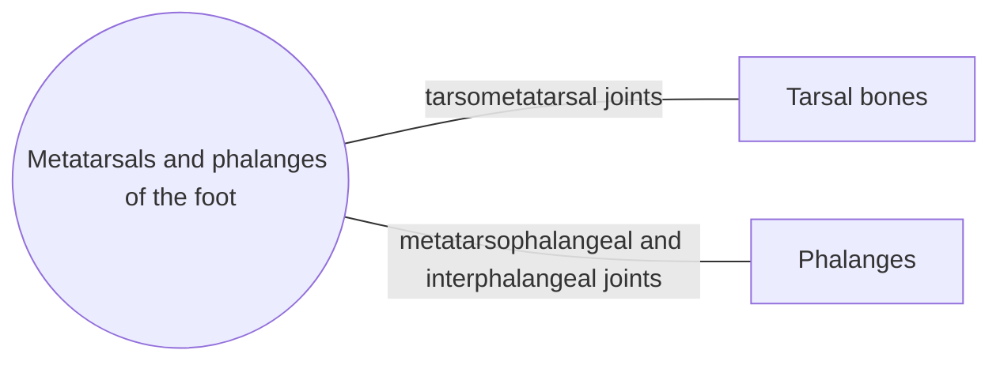

# Metatarsals and phalanges of the foot

## Summary

The five metatarsals form the front of the foot and the fourteen phalanges form the toes: two in the big toe and three in each other toe. The heads of the metatarsals form the ball of the foot, which carries much of the body weight when pushing off in walking.

## Prerequisites

- [Skeletal system overview](../skeletal-system-overview.md)

## Core concepts

### Definition

The *metatarsals* are five long bones (I to V from the big toe), each with base, shaft and head. The *phalanges* of the foot are short; the big toe (hallux) has a proximal and distal phalanx, the other toes three each. Latin: *ossa metatarsi et phalanges pedis*.

### Analogy

The forefoot is like the flexible front edge of a ski: it bends at the metatarsophalangeal joints during push-off, and the big toe acts as the final lever. The analogy breaks because the metatarsals must also spread and absorb load, which a ski does not.

### Mechanism

At push-off, the toes extend at the metatarsophalangeal joints, which tightens the plantar fascia and raises the arch (windlass mechanism), turning the foot into a rigid lever. Two sesamoid bones lie under the head of the first metatarsal in the flexor hallucis brevis tendons.

The diagram shows the bones this bone meets and the joints it forms.

### Landmarks

| Landmark | Description |
| --- | --- |
| Metatarsal I | Thickest; carries most load; sesamoids underneath |
| Metatarsal V tuberosity | Fibularis brevis insertion |
| Metatarsal heads | Ball of the foot |
| Phalanges | Two in hallux, three in other toes |

### Muscle attachments

Fibularis brevis and tertius (metatarsal V), fibularis longus and tibialis anterior (metatarsal I base), interossei, flexors and extensors of the toes, abductor and adductor hallucis.

## Worked example

A sudden increase in running or marching distance can cause a stress fracture of the second metatarsal ("march fracture"), the longest and least mobile metatarsal. Pain on the top of the forefoot that worsens with activity, with local tenderness, is typical.

## Trade offs and when to use it

Long, thin metatarsals act as springs and levers but are prone to stress fractures with rapidly increased loads.

## Common mistakes

- **Counting three phalanges in the big toe.** The big toe has two.

## Practice

1. What is the windlass mechanism?
2. Which metatarsal is most often affected by a march fracture?

### Answers

1. Extension of the toes at push-off tightens the plantar fascia and raises the arch, stiffening the foot.
2. The second.

## Further reading

- Standring, S. (Ed.) (2020). *Gray's Anatomy: The Anatomical Basis of Clinical Practice (42nd ed.)*. Elsevier. Reference text for attachments, innervation and relations.
- Betts, J. G., Young, K. A., Wise, J. A. et al. (2022). *Anatomy and Physiology 2e*. OpenStax, Rice University. [Link](https://openstax.org/details/books/anatomy-and-physiology-2e). Open textbook with illustrations of the skeletal and muscular systems.
