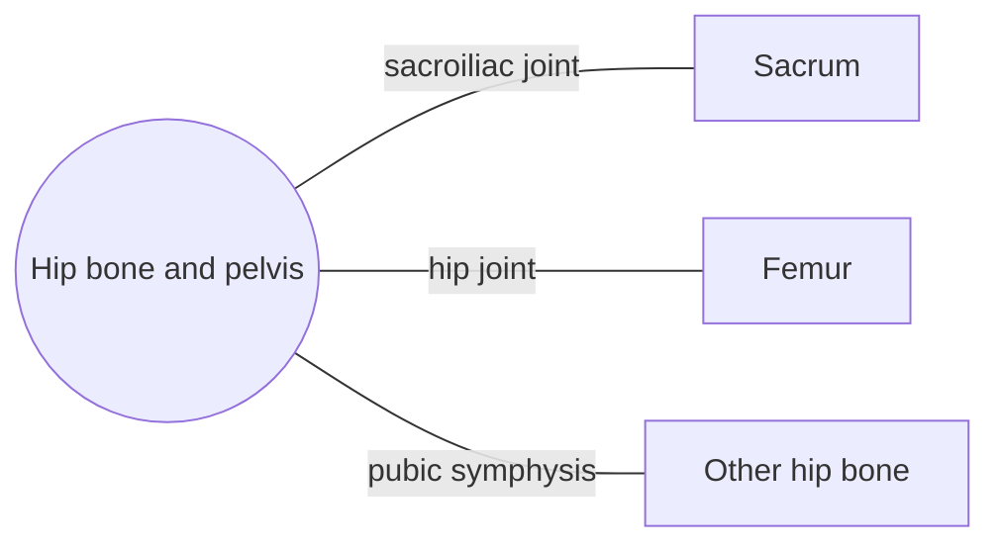

# Hip bone and pelvis

## Summary

Each hip bone forms from three bones that fuse at the hip socket: the ilium, ischium and pubis. The two hip bones and the sacrum form the pelvis, a ring that carries the weight of the trunk to the legs and protects the pelvic organs. The pelvis differs between men and women, mainly because the female pelvis is shaped for childbirth.

## Prerequisites

- [Skeletal system overview](../skeletal-system-overview.md)

## Core concepts

### Definition

The *hip bone* (os coxae, innominate bone) is a paired, large, irregular bone formed by the fusion of the *ilium* (upper fan-shaped part), the *ischium* (lower back part, which we sit on) and the *pubis* (front part). They meet in the *acetabulum*, the socket of the hip joint, and fuse by about age 15 to 17. Latin: *os coxae*.

### Analogy

The pelvis is like a strong basin with a hole in its floor. Its rim (iliac crests) anchors the trunk and abdominal muscles, its sockets hold the legs, and the bowl carries and protects the organs. The analogy breaks because the bowl's floor is closed by muscles (the pelvic floor), not bone.

### Mechanism

The weight of the trunk passes from the sacrum through the sacroiliac joints into the ilium, then to the acetabulum and femur when standing, or to the ischial tuberosities when sitting. The two pubic bones meet in front at the pubic symphysis. The obturator foramen, mostly closed by a membrane, lightens the bone.

The diagram shows the bones this bone meets and the joints it forms.

### Landmarks

| Landmark | Description |
| --- | --- |
| Iliac crest | Upper rim; abdominal muscles and latissimus dorsi attach |
| Anterior superior iliac spine | Palpable at the front of the hip; sartorius and inguinal ligament |
| Posterior superior iliac spine | Marked by dimples above the buttocks |
| Iliac fossa | Origin of iliacus |
| Gluteal surface | Origins of gluteus maximus, medius, minimus |
| Acetabulum | Socket of the hip joint |
| Ischial tuberosity | Sitting bone; hamstrings origin |
| Pubic symphysis | Joint between the pubic bones |
| Obturator foramen | Large opening closed by a membrane |

### Muscle attachments

Gluteal muscles, iliacus, hamstrings, adductors, sartorius, rectus femoris, tensor fasciae latae, abdominal muscles, quadratus lumborum, latissimus dorsi, piriformis (in part), obturator muscles, pelvic floor.

### Male and female pelvis

| Feature | Typical female pelvis | Typical male pelvis |
| --- | --- | --- |
| Pelvic inlet | Round or oval, wider | Heart-shaped, narrower |
| Subpubic angle | Wider, about 80 to 90 degrees or more | Narrower, about 50 to 60 degrees |
| Iliac blades | Flatter, flare more | More upright |
| Sacrum | Shorter, wider, less curved | Longer, narrower |

The shape of the pelvis, the width between the hip bones and the length of the femoral necks also influence the visible shape of the hips and buttocks (see [Glute training by shape](../../../exercise-and-fitness/training-types/glute-training-by-shape.md)).

## Worked example

An older person who falls sideways may break the pubic rami (the thin bars of the pubis) rather than the hip itself. The pain is in the groin, and walking is painful but possible. Because the pelvis is a ring, a fracture in one place is often matched by a second injury elsewhere in the ring.

## Trade offs and when to use it

A wide female pelvis eases childbirth but changes the angle of the femur toward the knee (larger Q angle), which is one factor discussed in knee injury risk.

## Common mistakes

- **Calling the iliac crest "the hip".** The hip joint lies deeper and lower, at the acetabulum.

## Practice

1. Which three bones fuse to form the hip bone?
2. Which part do we sit on?
3. What forms the pelvic ring?

### Answers

1. Ilium, ischium and pubis.
2. The ischial tuberosities.
3. The two hip bones and the sacrum.

## Further reading

- Standring, S. (Ed.) (2020). *Gray's Anatomy: The Anatomical Basis of Clinical Practice (42nd ed.)*. Elsevier. Reference text for attachments, innervation and relations.
- Betts, J. G., Young, K. A., Wise, J. A. et al. (2022). *Anatomy and Physiology 2e*. OpenStax, Rice University. [Link](https://openstax.org/details/books/anatomy-and-physiology-2e). Open textbook with illustrations of the skeletal and muscular systems.
