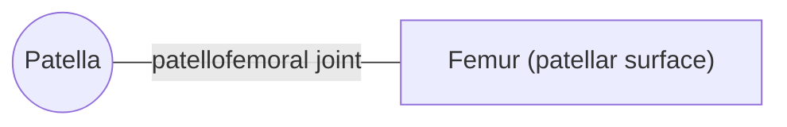

# Patella

## Summary

The patella (kneecap) is the largest sesamoid bone in the body, embedded in the tendon of the quadriceps. It glides in a groove on the front of the femur and increases the lever arm of the quadriceps on the tibia. Its back surface has the thickest cartilage in the body.

## Prerequisites

- [Skeletal system overview](../skeletal-system-overview.md)

## Core concepts

### Definition

The *patella* is a triangular sesamoid bone with its base above and its apex below. The quadriceps tendon attaches to its base, and the patellar ligament runs from its apex to the tibial tuberosity. Latin: *patella*.

### Analogy

The patella acts like a pulley block that moves the rope (quadriceps tendon) forward away from the joint, increasing the lever arm. With a longer lever, the same muscle force produces more torque to extend the knee. The analogy breaks because the pulley itself is pressed hard against the femur, with compressive forces of several times body weight in a deep squat.

### Mechanism

The patella increases the moment arm of the quadriceps by roughly 30 to 50 percent depending on knee angle. It also protects the front of the knee. Its tracking depends on the pull of the vastus medialis and lateralis, the shape of the femoral groove and the alignment of the leg.

The diagram shows the bones this bone meets and the joints it forms.

### Landmarks

| Landmark | Description |
| --- | --- |
| Base | Quadriceps tendon attaches |
| Apex | Patellar ligament begins |
| Articular surface | Medial and lateral facets; thick cartilage |
| Anterior surface | Rough, under the skin and prepatellar bursa |

### Muscle attachments

Quadriceps femoris (rectus femoris and vasti via the quadriceps tendon), patellar ligament to tibia.

## Worked example

In patellofemoral pain ("runner's knee"), pain around the kneecap rises with stairs, squats and long sitting. Stair descent can load the patellofemoral joint with about 3 to 4 times body weight. Strengthening the hip and knee extensors over weeks is the main treatment with good evidence.

## Trade offs and when to use it

The pulley effect boosts knee extension strength but puts high pressure on the patellar cartilage.

## Common mistakes

- **Calling the patellar ligament a tendon without context.** It connects bone to bone (patella to tibia), so anatomists call it a ligament, although functionally it continues the quadriceps tendon.

## Practice

1. Which type of bone is the patella?
2. How does the patella help the quadriceps?

### Answers

1. A sesamoid bone.
2. It increases the lever arm of the quadriceps.

## Further reading

- Standring, S. (Ed.) (2020). *Gray's Anatomy: The Anatomical Basis of Clinical Practice (42nd ed.)*. Elsevier. Reference text for attachments, innervation and relations.
- Betts, J. G., Young, K. A., Wise, J. A. et al. (2022). *Anatomy and Physiology 2e*. OpenStax, Rice University. [Link](https://openstax.org/details/books/anatomy-and-physiology-2e). Open textbook with illustrations of the skeletal and muscular systems.
