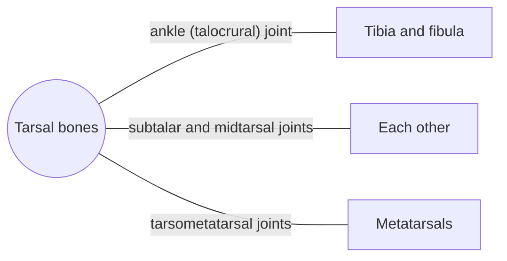

# Tarsal bones

## Summary

The seven tarsal bones form the back half of the foot: talus, calcaneus, navicular, cuboid and three cuneiforms. The talus carries the body weight from the leg and passes it to the heel and forefoot; the calcaneus forms the heel. Together they build the arches of the foot.

## Prerequisites

- [Skeletal system overview](../skeletal-system-overview.md)

## Core concepts

### Definition

The *tarsal bones* are seven short bones: the *talus* (ankle bone), *calcaneus* (heel bone), *navicular*, *cuboid* and the *medial, intermediate and lateral cuneiforms*. Latin: *ossa tarsi*.

### Analogy

The tarsal bones are like the stones of an arched bridge: shaped and wedged together so that weight pressing from above tightens the arch. Ligaments and muscles act as the tie rods. The analogy breaks because the foot's arch must also flatten slightly and spring back with each step, which a stone bridge never does.

### Mechanism

The talus sits in the mortise formed by the tibia and fibula (ankle joint) and on the calcaneus (subtalar joint, which allows inversion and eversion). No muscles attach to the talus. The calcaneus receives the Achilles tendon. The medial longitudinal arch runs through calcaneus, talus, navicular, cuneiforms and metatarsals I to III.

The diagram shows the bones this bone meets and the joints it forms.

### Landmarks

| Landmark | Description |
| --- | --- |
| Talus | Ankle and subtalar joints; no muscle attachments |
| Calcaneus | Heel; calcaneal tuberosity for the Achilles tendon |
| Navicular | Medial side; tibialis posterior inserts |
| Cuboid | Lateral side; groove for fibularis longus tendon |
| Cuneiforms | Medial, intermediate, lateral; base of the arch |

### Muscle attachments

Triceps surae (Achilles tendon to calcaneus), tibialis posterior (navicular, cuneiforms), tibialis anterior and fibularis longus (medial cuneiform), extensor digitorum brevis and plantar muscles (calcaneus), plantar fascia.

## Worked example

Plantar heel pain (plantar fasciitis) is felt at the inner front of the calcaneus, where the plantar fascia attaches. Pain is typically worst with the first steps in the morning. Calf and plantar fascia stretching, load management and supportive footwear help most cases within months.

## Trade offs and when to use it

Arched construction distributes load and stores elastic energy in walking and running, but collapse (flat foot) or excessive rigidity changes how load travels up the leg.

## Common mistakes

- **Calling the talus the heel bone.** The calcaneus is the heel bone; the talus sits above it.

## Practice

1. Which tarsal bone has no muscle attachments?
2. Which tendon attaches to the calcaneus?

### Answers

1. The talus.
2. The Achilles (calcaneal) tendon.

## Further reading

- Standring, S. (Ed.) (2020). *Gray's Anatomy: The Anatomical Basis of Clinical Practice (42nd ed.)*. Elsevier. Reference text for attachments, innervation and relations.
- Betts, J. G., Young, K. A., Wise, J. A. et al. (2022). *Anatomy and Physiology 2e*. OpenStax, Rice University. [Link](https://openstax.org/details/books/anatomy-and-physiology-2e). Open textbook with illustrations of the skeletal and muscular systems.
