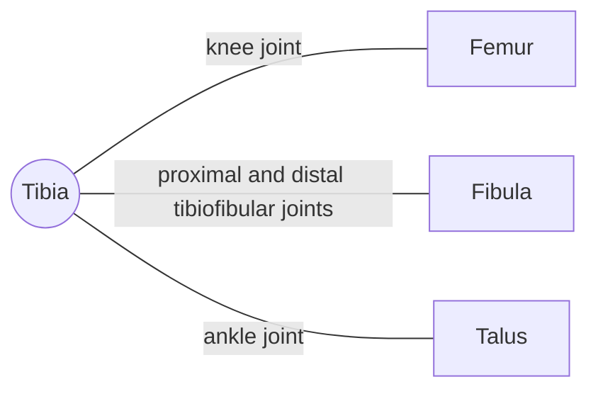

# Tibia

## Summary

The tibia (shinbone) is the larger, weight-bearing bone of the lower leg. Its flat upper surface (tibial plateau) forms the knee with the femur, and its lower end forms the ankle with the talus, including the inner ankle bone (medial malleolus). Its front edge lies just under the skin along the shin.

## Prerequisites

- [Skeletal system overview](../skeletal-system-overview.md)

## Core concepts

### Definition

The *tibia* is a paired long bone on the medial side of the leg, with medial and lateral condyles above, a triangular shaft and a distal end with the medial malleolus. Latin: *tibia*.

### Analogy

The tibia is like the main pillar of a two-pillar bridge: it carries almost all the load, while the fibula beside it is a slender stabilizing rod. The analogy breaks because the pillar has a joint at each end and moves.

### Mechanism

The tibial plateau carries the menisci and the cruciate ligaments attach to the area between the condyles. The tibial tuberosity receives the patellar ligament. The medial surface of the shaft lies directly under the skin, which is why shin knocks hurt and why open fractures of the tibia are common.

The diagram shows the bones this bone meets and the joints it forms.

### Landmarks

| Landmark | Description |
| --- | --- |
| Medial and lateral condyles (plateau) | Knee joint |
| Intercondylar eminence | Cruciate ligament and menisci attachments |
| Tibial tuberosity | Patellar ligament |
| Anterior border (shin) | Under the skin |
| Medial malleolus | Inner ankle bone |
| Inferior articular surface | Ankle joint with talus |

### Muscle attachments

Quadriceps (via patellar ligament), sartorius, gracilis and semitendinosus (pes anserinus), semimembranosus, popliteus, tibialis anterior, tibialis posterior, soleus, flexor digitorum longus.

## Worked example

"Shin splints" (medial tibial stress syndrome) cause diffuse pain along the inner edge of the tibia in runners who increase their training too quickly. A small, very tender spot instead suggests a stress fracture, which needs longer rest. The difference matters for how long training must be reduced.

## Trade offs and when to use it

Bearing most of the load makes the tibia strong but vulnerable to stress fractures when loading rises faster than bone remodeling.

## Common mistakes

- **Calling both ankle bumps part of the tibia.** The inner bump is the tibia (medial malleolus); the outer is the fibula (lateral malleolus).

## Practice

1. What attaches to the tibial tuberosity?
2. Which bone forms the inner ankle bone?

### Answers

1. The patellar ligament.
2. The tibia (medial malleolus).

## Further reading

- Standring, S. (Ed.) (2020). *Gray's Anatomy: The Anatomical Basis of Clinical Practice (42nd ed.)*. Elsevier. Reference text for attachments, innervation and relations.
- Betts, J. G., Young, K. A., Wise, J. A. et al. (2022). *Anatomy and Physiology 2e*. OpenStax, Rice University. [Link](https://openstax.org/details/books/anatomy-and-physiology-2e). Open textbook with illustrations of the skeletal and muscular systems.
