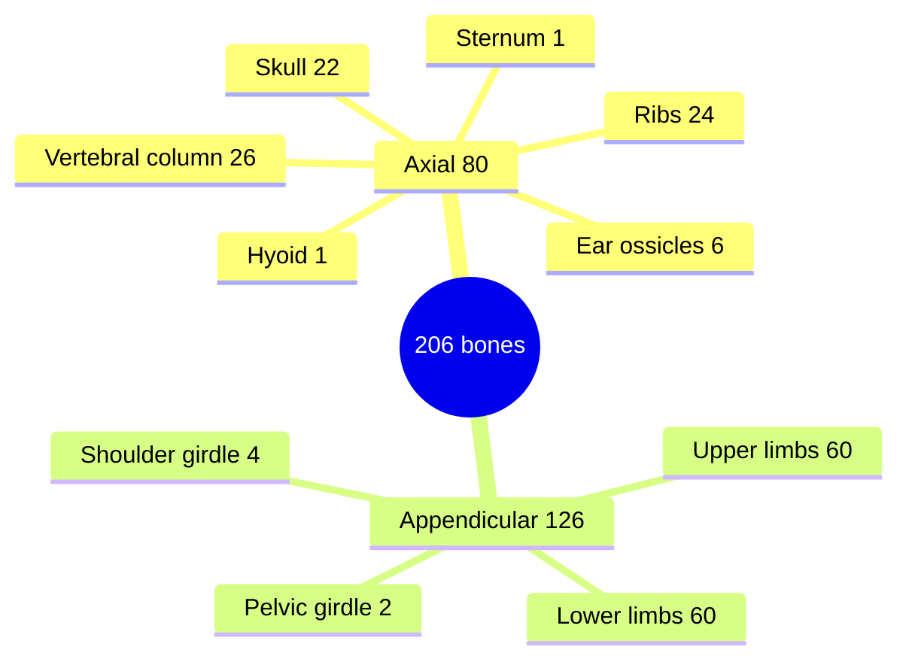

# Skeletal system overview

## Summary

The adult human skeleton has about 206 bones, divided into the axial skeleton (skull, vertebral column, ribs and sternum, 80 bones) and the appendicular skeleton (limbs with the shoulder and pelvic girdles, 126 bones). Bones support the body, protect organs, act as levers for muscles, store calcium and phosphate, and house the bone marrow that makes blood cells. Bones are classified by shape as long, short, flat, irregular or sesamoid.

## Prerequisites

- [Directional terms](../anatomical-terminology/directional-terms.md)

## Core concepts

### Definition

The *skeletal system* comprises the bones, the cartilage and the ligaments that connect them. The *axial skeleton* forms the central axis of the body, and the *appendicular skeleton* the limbs and the girdles that attach them to the axial skeleton. The number 206 is typical for adults; newborns have about 270 bony elements, many of which fuse during growth, and the count varies with extra small bones (sesamoids, sutural bones).

### Analogy

The skeleton is like the steel frame of a building combined with a bank vault and a factory. The frame holds the shape and carries the load, the vault (skull, rib cage) protects valuables, and the factory in the basement (red bone marrow) produces blood cells. Bones also act as the bank's reserve of calcium. The analogy breaks because a steel frame never rebuilds itself, while bone is remodeled throughout life and adapts its shape to the loads it carries.

### Mechanism

**Functions.**

1. Support and shape.
2. Protection: skull for the brain, rib cage for heart and lungs, vertebrae for the spinal cord, pelvis for pelvic organs.
3. Movement: bones are levers moved by muscles at joints.
4. Mineral storage: about 99 percent of body calcium and 85 percent of phosphate.
5. Blood cell production in red marrow (hematopoiesis).
6. Energy storage as fat in yellow marrow, and endocrine signals (osteocalcin, FGF23).

**Bone shapes.**

| Shape | Description | Examples |
| --- | --- | --- |
| Long | Longer than wide, with a shaft and two ends | Femur, humerus, phalanges |
| Short | Cube-like | Carpal and tarsal bones |
| Flat | Thin, often curved | Sternum, ribs, scapula, skull vault |
| Irregular | Complex shapes | Vertebrae, sphenoid, hip bone |
| Sesamoid | Small bones inside tendons | Patella |

The map shows the main divisions and bone counts.

### Counting the bones

| Region | Bones |
| --- | --- |
| Skull | 8 cranial and 14 facial bones |
| Ear ossicles | 6 (malleus, incus, stapes on each side) |
| Hyoid | 1 |
| Vertebral column | 26 (24 vertebrae, sacrum, coccyx) |
| Thorax | 1 sternum and 24 ribs |
| Shoulder girdle | 2 clavicles and 2 scapulae |
| Upper limbs | 2 × 30 (humerus, radius, ulna, 8 carpals, 5 metacarpals, 14 phalanges) |
| Pelvic girdle | 2 hip bones |
| Lower limbs | 2 × 30 (femur, patella, tibia, fibula, 7 tarsals, 5 metatarsals, 14 phalanges) |

## Worked example

Why are there 26 bones in the vertebral column but 33 or 34 vertebrae? The 5 sacral vertebrae fuse into one sacrum and the 4 or 5 coccygeal vertebrae fuse into one coccyx, so 7 cervical + 12 thoracic + 5 lumbar + 1 sacrum + 1 coccyx = 26 bones. Counting conventions explain many of the different numbers found in sources.

## Trade offs and when to use it

- Light, strong bones are a trade off: bone is dense where loads are high and spongy where they are low, which saves weight. Low loading (bed rest, space flight) leads to bone loss within weeks.

## Common mistakes

- **Thinking bones are inert.** Bone is living tissue that remodels constantly ([Bone tissue](bone-tissue.md)).
- **Assuming everyone has exactly 206 bones.** Sesamoid and sutural bones vary.

## Practice

1. Name the two divisions of the skeleton.
2. Which shape class does the patella belong to?
3. How many bones are in each upper limb, including the hand?

### Answers

1. The axial skeleton and the appendicular skeleton.
2. Sesamoid.
3. 30.

## Further reading

- Standring, S. (Ed.) (2020). *Gray's Anatomy: The Anatomical Basis of Clinical Practice (42nd ed.)*. Elsevier. Reference text for attachments, innervation and relations.
- Betts, J. G., Young, K. A., Wise, J. A. et al. (2022). *Anatomy and Physiology 2e*. OpenStax, Rice University. [Link](https://openstax.org/details/books/anatomy-and-physiology-2e). Open textbook with illustrations of the skeletal and muscular systems.
