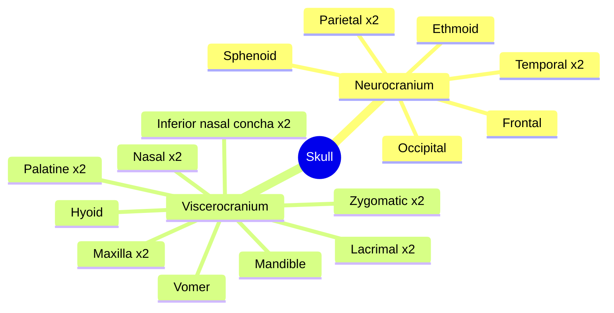

# Skull

The skull (cranium) is the skeleton of the head. It protects the brain and the sense organs, surrounds the start of the airways and the digestive tract, and anchors the muscles of chewing and facial expression. It has two parts: the neurocranium, which encloses the brain, and the viscerocranium (facial skeleton). This subfield has one note per bone.

## Map

The map lists the bones of each part. Paired bones occur on both sides.

## Reading order

1. [Skull overview](skull-overview.md): the parts of the skull, sutures, fontanelles and the cranial fossae.

Neurocranium:

2. [Frontal bone](frontal-bone.md)
3. [Parietal bone](parietal-bone.md)
4. [Temporal bone](temporal-bone.md)
5. [Occipital bone](occipital-bone.md)
6. [Sphenoid bone](sphenoid-bone.md)
7. [Ethmoid bone](ethmoid-bone.md)

Viscerocranium:

8. [Nasal bone](nasal-bone.md)
9. [Lacrimal bone](lacrimal-bone.md)
10. [Inferior nasal concha](inferior-nasal-concha.md)
11. [Vomer](vomer.md)
12. [Maxilla](maxilla.md)
13. [Palatine bone](palatine-bone.md)
14. [Zygomatic bone](zygomatic-bone.md)
15. [Mandible](mandible.md)
16. [Hyoid bone](hyoid-bone.md)
