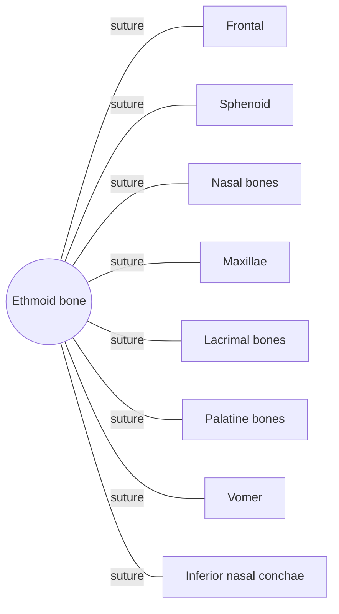

# Ethmoid bone

## Summary

The ethmoid is a light, sponge-like bone between the orbits. It forms the roof and much of the walls of the nasal cavity, part of the nasal septum and the inner walls of the orbits. Its cribriform plate lets the olfactory nerve fibers pass from the nose to the brain.

## Prerequisites

- [Skull overview](skull-overview.md)

## Core concepts

### Definition

The *ethmoid bone* ("sieve-like") is an unpaired, irregular bone of the neurocranium consisting of the horizontal cribriform plate, the vertical perpendicular plate (upper nasal septum) and two labyrinths with air cells (ethmoid sinuses), which carry the superior and middle nasal conchae. Latin: *os ethmoidale*.

### Analogy

The cribriform plate is like a sieve in a kitchen sink: many small holes let fine threads (olfactory nerve fibers) pass from the nasal cavity to the brain. The analogy breaks because a fracture of this "sieve" can let cerebrospinal fluid leak into the nose.

### Mechanism

It separates the nasal cavity from the brain, carries the smell nerve fibers, forms the upper septum and the superior and middle conchae, which increase the surface for warming and humidifying air, and contains the ethmoid air cells. The crista galli above the cribriform plate anchors the falx cerebri.

The diagram shows the bones this bone meets and the joints it forms.

### Landmarks

| Landmark | Description |
| --- | --- |
| Cribriform plate | Perforated roof of the nasal cavity for olfactory nerves |
| Crista galli | Ridge anchoring the falx cerebri |
| Perpendicular plate | Upper part of nasal septum |
| Ethmoid labyrinths | Air cells (ethmoid sinuses) |
| Superior and middle nasal conchae | Scroll-shaped shelves in the nasal cavity |
| Orbital plate | Thin medial wall of the orbit (lamina papyracea) |

### Muscle attachments

No major muscles attach.

## Worked example

After a head injury, clear watery fluid dripping from the nose that increases when leaning forward may be cerebrospinal fluid from a fracture of the cribriform plate. Loss of smell (anosmia) can also follow, because the olfactory fibers are sheared.

## Trade offs and when to use it

Its paper-thin orbital plate lets ethmoid sinus infections spread into the orbit, a dangerous complication in children.

## Common mistakes

- **Thinking the inferior nasal concha belongs to the ethmoid.** The superior and middle conchae are ethmoid; the inferior concha is a separate bone.

## Practice

1. Which nerve passes through the cribriform plate?
2. Which nasal conchae are part of the ethmoid?

### Answers

1. The olfactory nerve (cranial nerve I).
2. The superior and middle conchae.

## Further reading

- Standring, S. (Ed.) (2020). *Gray's Anatomy: The Anatomical Basis of Clinical Practice (42nd ed.)*. Elsevier. Reference text for attachments, innervation and relations.
- Betts, J. G., Young, K. A., Wise, J. A. et al. (2022). *Anatomy and Physiology 2e*. OpenStax, Rice University. [Link](https://openstax.org/details/books/anatomy-and-physiology-2e). Open textbook with illustrations of the skeletal and muscular systems.
