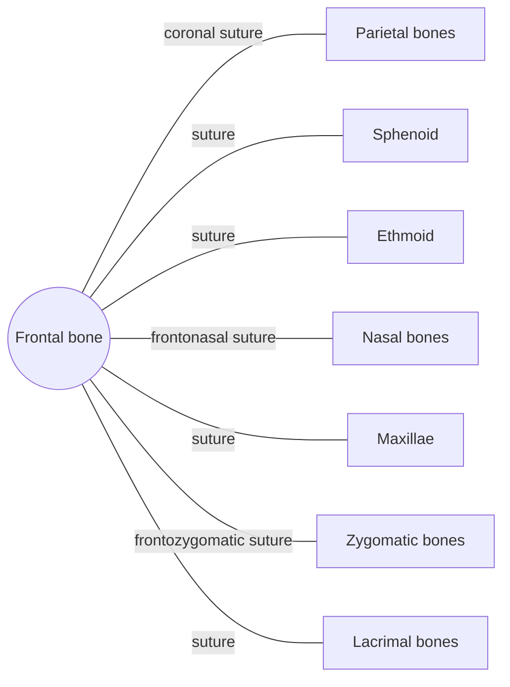

# Frontal bone

## Summary

The frontal bone forms the forehead, the roofs of the orbits and the front of the cranial floor. It contains the frontal sinuses, air spaces that drain into the nose. It begins as two halves that usually fuse in early childhood.

## Prerequisites

- [Skull overview](skull-overview.md)

## Core concepts

### Definition

The *frontal bone* is an unpaired flat bone of the neurocranium. It has a vertical part (squama) forming the forehead, two horizontal orbital parts forming the orbital roofs, and a nasal part. Latin: *os frontale*.

### Analogy

The frontal bone is like the visor and front panel of a helmet: it takes frontal impacts and shields the eyes from above. The analogy breaks because it is hollow in places: the frontal sinuses lighten it and act as crumple zones.

### Mechanism

It protects the frontal lobes of the brain, forms part of the orbit and nasal cavity, and gives attachment to the scalp muscle (frontal belly of occipitofrontalis) and the temporalis. Its sinuses warm and humidify air and reduce skull weight.

The diagram shows the bones this bone meets and the joints it forms.

### Landmarks

| Landmark | Description |
| --- | --- |
| Squama | Curved plate of the forehead |
| Supraorbital margin and foramen (or notch) | Upper rim of the orbit; passage for supraorbital nerve and vessels |
| Superciliary arches | Ridges above the eyebrows |
| Glabella | Smooth area between the eyebrows |
| Frontal sinuses | Paired air spaces behind the brow |
| Orbital plates | Roofs of the orbits |

### Muscle attachments

Frontal belly of occipitofrontalis (via the galea), corrugator supercilii, orbicularis oculi, temporalis (temporal line).

### Development

The two halves are joined by the metopic suture, which usually closes in the first two years. In a minority of adults it persists, which can be mistaken for a fracture on X-rays.

## Worked example

Frontal sinusitis causes pain over the forehead that worsens when bending forward, because the inflamed sinus cannot drain well through its narrow duct into the middle nasal meatus.

## Trade offs and when to use it

The sinuses lighten the skull but can become infected, and in severe cases infection can spread to the orbit or brain.

## Common mistakes

- **Confusing the glabella with the nasion.** The glabella is between the eyebrows; the nasion is the point where the frontal and nasal bones meet.

## Practice

1. Which suture joins the frontal and parietal bones?
2. Where do the frontal sinuses drain?

### Answers

1. The coronal suture.
2. Into the middle nasal meatus through the frontonasal duct.

## Further reading

- Standring, S. (Ed.) (2020). *Gray's Anatomy: The Anatomical Basis of Clinical Practice (42nd ed.)*. Elsevier. Reference text for attachments, innervation and relations.
- Betts, J. G., Young, K. A., Wise, J. A. et al. (2022). *Anatomy and Physiology 2e*. OpenStax, Rice University. [Link](https://openstax.org/details/books/anatomy-and-physiology-2e). Open textbook with illustrations of the skeletal and muscular systems.
