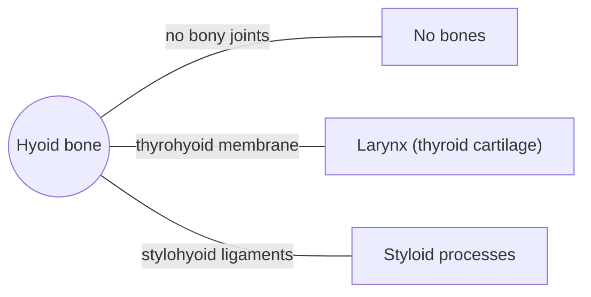

# Hyoid bone

## Summary

The hyoid is a U-shaped bone in the front of the neck, just above the larynx, that touches no other bone. It hangs from muscles and ligaments and anchors the tongue and the muscles that move the larynx during swallowing and speech. It can be felt in the midline below the chin.

## Prerequisites

- [Skull overview](skull-overview.md)

## Core concepts

### Definition

The *hyoid bone* is an unpaired, U-shaped bone with a body, two greater horns and two lesser horns. It is often counted with the viscerocranium but is suspended in the neck, attached to the styloid processes by ligaments and to the larynx by the thyrohyoid membrane. Latin: *os hyoideum*.

### Analogy

The hyoid is like the anchor point of a tent held only by ropes: muscles pull it up toward the jaw and skull (suprahyoid muscles) and down toward the sternum, scapula and larynx (infrahyoid muscles). By balancing the ropes, the body positions the hyoid and with it the tongue and larynx. The analogy breaks because the ropes also move the anchor in quick sequences during swallowing.

### Mechanism

During swallowing the suprahyoid muscles lift the hyoid and larynx up and forward, which helps close the airway and open the esophagus. The infrahyoid muscles then return it. The hyoid also forms the base for tongue movements in speech.

The diagram shows the bones this bone meets and the joints it forms.

### Landmarks

| Landmark | Description |
| --- | --- |
| Body | Front part, palpable in the midline |
| Greater horns | Project backward on each side |
| Lesser horns | Small cones for the stylohyoid ligaments |

### Muscle attachments

Suprahyoid muscles: [Digastric](../../muscular-system/head-and-neck/digastric.md), [Stylohyoid](../../muscular-system/head-and-neck/stylohyoid.md), [Mylohyoid](../../muscular-system/head-and-neck/mylohyoid.md), [Geniohyoid](../../muscular-system/head-and-neck/geniohyoid.md). Infrahyoid muscles: [Sternohyoid](../../muscular-system/head-and-neck/sternohyoid.md), [Omohyoid](../../muscular-system/head-and-neck/omohyoid.md), [Thyrohyoid](../../muscular-system/head-and-neck/thyrohyoid.md) (and the sternothyroid acts through the thyroid cartilage). Also hyoglossus and middle pharyngeal constrictor.

## Worked example

In forensic medicine, a fractured hyoid in an adult raises suspicion of strangulation, because the bone is protected and rarely breaks otherwise. In young people the hyoid is less often fractured because its parts are not yet fused.

## Trade offs and when to use it

Its free suspension allows a wide range of movement for swallowing and speech.

## Common mistakes

- **Thinking the hyoid is part of the larynx.** It is a separate bone above the larynx, linked by a membrane.

## Practice

1. Why is the hyoid unusual among bones?
2. Which muscle group lifts the hyoid during swallowing?

### Answers

1. It does not articulate with any other bone.
2. The suprahyoid muscles.

## Further reading

- Standring, S. (Ed.) (2020). *Gray's Anatomy: The Anatomical Basis of Clinical Practice (42nd ed.)*. Elsevier. Reference text for attachments, innervation and relations.
- Betts, J. G., Young, K. A., Wise, J. A. et al. (2022). *Anatomy and Physiology 2e*. OpenStax, Rice University. [Link](https://openstax.org/details/books/anatomy-and-physiology-2e). Open textbook with illustrations of the skeletal and muscular systems.
