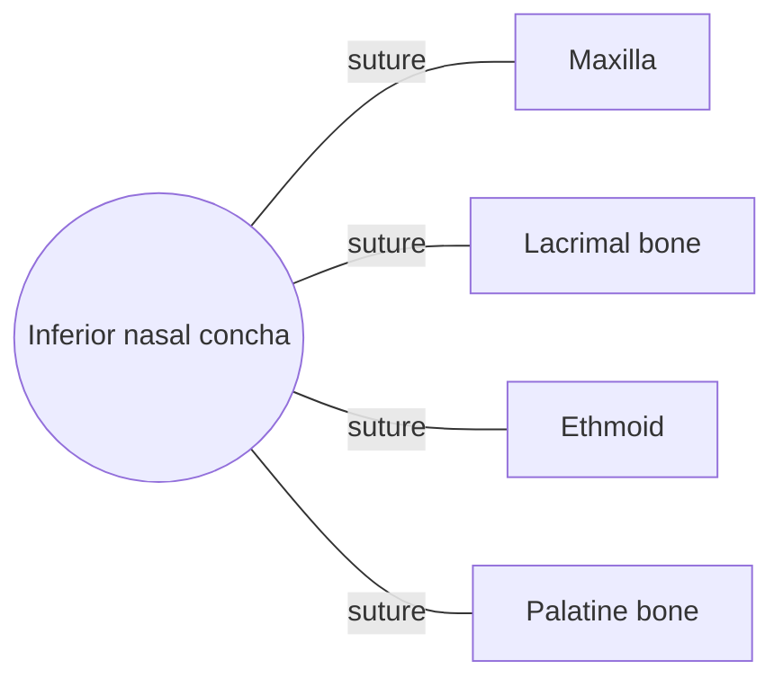

# Inferior nasal concha

## Summary

The inferior nasal conchae are paired, scroll-shaped bones on the side walls of the nasal cavity. Covered with mucosa rich in blood vessels, they warm, humidify and filter inhaled air. They are separate bones, unlike the superior and middle conchae, which belong to the ethmoid.

## Prerequisites

- [Skull overview](skull-overview.md)

## Core concepts

### Definition

The *inferior nasal concha* (turbinate) is a paired, curved, thin bone of the viscerocranium attached to the lateral wall of the nasal cavity, below the middle concha. Latin: *concha nasalis inferior*.

### Analogy

The conchae are like the fins of a radiator. They increase the surface area so that air passing through the nose is warmed and moistened before reaching the lungs. The analogy breaks because the "radiator" can swell: the mucosa over the conchae fills with blood and blocks one side of the nose and then the other in a cycle.

### Mechanism

The space under each concha is a meatus. The inferior meatus receives the nasolacrimal duct. The thick erectile mucosa over the inferior concha swells and shrinks in the nasal cycle every few hours.

The diagram shows the bones this bone meets and the joints it forms.

### Landmarks

| Landmark | Description |
| --- | --- |
| Medial surface | Convex, faces the septum |
| Lateral surface | Concave, forms the inferior meatus |
| Lacrimal, ethmoidal and maxillary processes | Attach to the lateral nasal wall |

## Worked example

In allergic rhinitis, the mucosa over the inferior conchae swells and blocks airflow. Decongestant sprays shrink it within minutes, but using them for more than a few days causes rebound swelling (rhinitis medicamentosa).

## Trade offs and when to use it

The conchae condition air efficiently, but swelling easily blocks the narrow nasal airway.

## Common mistakes

- **Thinking all three conchae are separate bones.** Only the inferior concha is a separate bone.

## Practice

1. What opens into the inferior meatus?
2. Name two functions of the conchae.

### Answers

1. The nasolacrimal duct.
2. Warming and humidifying air (also filtering).

## Further reading

- Standring, S. (Ed.) (2020). *Gray's Anatomy: The Anatomical Basis of Clinical Practice (42nd ed.)*. Elsevier. Reference text for attachments, innervation and relations.
- Betts, J. G., Young, K. A., Wise, J. A. et al. (2022). *Anatomy and Physiology 2e*. OpenStax, Rice University. [Link](https://openstax.org/details/books/anatomy-and-physiology-2e). Open textbook with illustrations of the skeletal and muscular systems.
