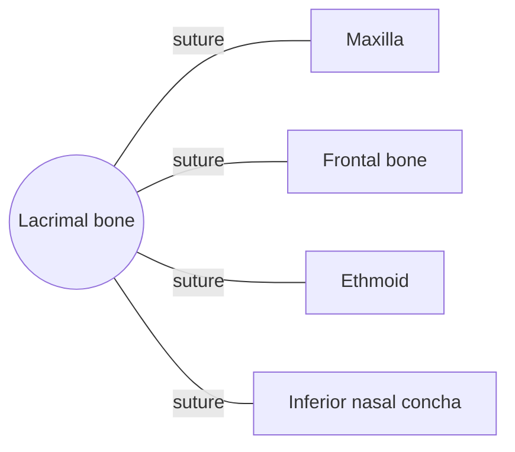

# Lacrimal bone

## Summary

The lacrimal bones are the smallest and most fragile bones of the face. Each forms part of the inner wall of an orbit and contains the groove for the tear sac, which drains tears into the nose.

## Prerequisites

- [Skull overview](skull-overview.md)

## Core concepts

### Definition

The *lacrimal bone* is a paired, thin, fingernail-sized flat bone of the viscerocranium, located in the front of the medial wall of the orbit. Latin: *os lacrimale*.

### Analogy

The lacrimal bone is like the gutter at the corner of a roof: tears collect in the sac in its groove and drain through a downpipe (the nasolacrimal duct) into the nose. The analogy breaks because the gutter is fragile and easily cracked.

### Mechanism

Its lacrimal groove, together with the maxilla, forms the fossa for the lacrimal sac. The nasolacrimal canal leads from there to the inferior nasal meatus, which is why crying makes the nose run.

The diagram shows the bones this bone meets and the joints it forms.

### Landmarks

| Landmark | Description |
| --- | --- |
| Lacrimal groove and fossa | Holds the lacrimal sac |
| Posterior lacrimal crest | Ridge behind the fossa |
| Lacrimal hamulus | Small hook toward the maxilla |

### Muscle attachments

Part of the orbicularis oculi (lacrimal part).

## Worked example

Babies sometimes have watery eyes for months because the lower end of the nasolacrimal duct has not opened yet. Gentle massage over the tear sac often helps, and most cases resolve by the first birthday.

## Trade offs and when to use it

Thin bone saves weight but fractures easily in orbital injuries.

## Common mistakes

- **Confusing the lacrimal gland with the lacrimal bone.** The gland lies in the upper outer orbit (frontal bone); the bone holds the drainage sac on the inner side.

## Practice

1. Where do tears drain?
2. Which is the smallest facial bone?

### Answers

1. Through the lacrimal sac and nasolacrimal duct into the inferior nasal meatus.
2. The lacrimal bone.

## Further reading

- Standring, S. (Ed.) (2020). *Gray's Anatomy: The Anatomical Basis of Clinical Practice (42nd ed.)*. Elsevier. Reference text for attachments, innervation and relations.
- Betts, J. G., Young, K. A., Wise, J. A. et al. (2022). *Anatomy and Physiology 2e*. OpenStax, Rice University. [Link](https://openstax.org/details/books/anatomy-and-physiology-2e). Open textbook with illustrations of the skeletal and muscular systems.
