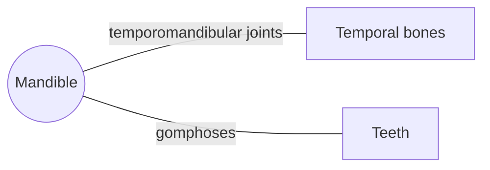

# Mandible

## Summary

The mandible is the lower jaw, the largest and strongest bone of the face and the only skull bone joined by a movable synovial joint. It carries the lower teeth and gives attachment to the muscles of chewing. It moves at the temporomandibular joints to open, close, protrude and grind.

## Prerequisites

- [Skull overview](skull-overview.md)

## Core concepts

### Definition

The *mandible* is an unpaired bone of the viscerocranium shaped like a horseshoe body with two vertical rami. Each ramus ends in a condylar process (the joint head) and a coronoid process (for the temporalis). Latin: *mandibula*.

### Analogy

The mandible is like the lower blade of a pair of pliers hinged at the back. Muscles on the outside (masseter) and inside (medial pterygoid) close it with great force near the hinge, where the lever arm favors force for crushing. The analogy breaks because the hinge also slides forward when the mouth opens wide.

### Mechanism

The condyles sit in the mandibular fossae of the temporal bones. Opening starts with rotation and continues with forward gliding of the condyles onto the articular tubercles. The mandibular canal carries the inferior alveolar nerve, which supplies the lower teeth and exits at the mental foramen to the chin and lower lip.

The diagram shows the bones this bone meets and the joints it forms.

### Landmarks

| Landmark | Description |
| --- | --- |
| Body | Horizontal part with the alveolar process for the lower teeth |
| Ramus | Vertical part |
| Angle | Junction of body and ramus; masseter and medial pterygoid insert |
| Condylar process | Head of the jaw joint |
| Coronoid process | Insertion of temporalis |
| Mandibular foramen and canal | Inferior alveolar nerve and vessels |
| Mental foramen | Mental nerve to chin and lip |
| Mental protuberance | The chin |
| Mylohyoid line | Origin of mylohyoid |
| Digastric fossa and mental spines | Origins of digastric and geniohyoid |

### Muscle attachments

Masseter, temporalis, medial and lateral pterygoids, digastric (anterior belly), mylohyoid, geniohyoid, genioglossus, platysma, muscles of the lower lip and chin, buccinator.

## Worked example

Dentists block the inferior alveolar nerve by injecting near the mandibular foramen on the inner side of the ramus. This numbs all the lower teeth on that side, and the lower lip and chin, which shows the course of the nerve through the mandible to the mental foramen.

## Trade offs and when to use it

Its ring shape means a single blow often breaks it in two places, for example at the angle on one side and the canine area on the other.

## Common mistakes

- **Calling the coronoid process the joint head.** The condylar process forms the joint; the coronoid process receives the temporalis.

## Practice

1. Which process of the mandible forms the jaw joint?
2. Which nerve runs in the mandibular canal?
3. Name two muscles that insert near the angle of the mandible.

### Answers

1. The condylar process.
2. The inferior alveolar nerve.
3. Masseter and medial pterygoid.

## Further reading

- Standring, S. (Ed.) (2020). *Gray's Anatomy: The Anatomical Basis of Clinical Practice (42nd ed.)*. Elsevier. Reference text for attachments, innervation and relations.
- Betts, J. G., Young, K. A., Wise, J. A. et al. (2022). *Anatomy and Physiology 2e*. OpenStax, Rice University. [Link](https://openstax.org/details/books/anatomy-and-physiology-2e). Open textbook with illustrations of the skeletal and muscular systems.
