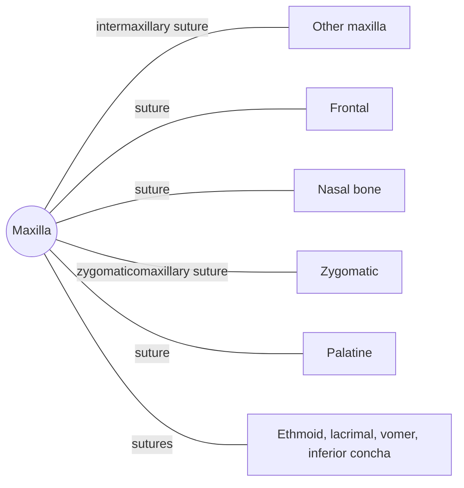

# Maxilla

## Summary

The two maxillae form the upper jaw. They carry the upper teeth, form most of the hard palate, the floor of the orbits and the side walls of the nasal cavity, and contain the largest paranasal sinuses. Every facial bone except the mandible touches them.

## Prerequisites

- [Skull overview](skull-overview.md)

## Core concepts

### Definition

The *maxilla* is a paired, irregular bone of the viscerocranium with a body containing the maxillary sinus and four processes: frontal, zygomatic, alveolar (carrying the teeth) and palatine. Latin: *maxilla*.

### Analogy

The maxillae are like the central frame of a car body to which the bumpers, doors and roof are bolted. Every other facial bone except the mandible attaches to them. The analogy breaks because this frame also carries hollow air spaces and teeth.

### Mechanism

The alveolar process holds the upper teeth in sockets. The palatine processes form the front two-thirds of the hard palate. The maxillary sinus drains into the middle nasal meatus. The infraorbital foramen passes the infraorbital nerve, which supplies sensation to the cheek and upper lip.

The diagram shows the bones this bone meets and the joints it forms.

### Landmarks

| Landmark | Description |
| --- | --- |
| Body and maxillary sinus | Largest paranasal sinus |
| Alveolar process | Sockets of upper teeth |
| Palatine process | Front of the hard palate |
| Frontal process | Side of the nose |
| Zygomatic process | Joins the cheekbone |
| Infraorbital foramen | Infraorbital nerve and vessels |
| Anterior nasal spine | Point at the base of the nose |

### Muscle attachments

Muscles of facial expression (levator labii superioris, levator anguli oris, nasalis, orbicularis oris), buccinator, masseter (via zygomatic process area), medial pterygoid (tuberosity).

## Worked example

Toothache in the upper back teeth can be referred sinus pain, and sinusitis can feel like toothache, because the roots of the upper molars lie close to or project into the floor of the maxillary sinus.

## Trade offs and when to use it

The large sinus lightens the face but brings dental and sinus problems close together.

## Common mistakes

- **Calling the maxilla movable.** The upper jaw is fixed; only the mandible moves.

## Practice

1. Where does the maxillary sinus drain?
2. Which nerve emerges from the infraorbital foramen?

### Answers

1. Into the middle nasal meatus.
2. The infraorbital nerve, a branch of the maxillary division of the trigeminal nerve.

## Further reading

- Standring, S. (Ed.) (2020). *Gray's Anatomy: The Anatomical Basis of Clinical Practice (42nd ed.)*. Elsevier. Reference text for attachments, innervation and relations.
- Betts, J. G., Young, K. A., Wise, J. A. et al. (2022). *Anatomy and Physiology 2e*. OpenStax, Rice University. [Link](https://openstax.org/details/books/anatomy-and-physiology-2e). Open textbook with illustrations of the skeletal and muscular systems.
