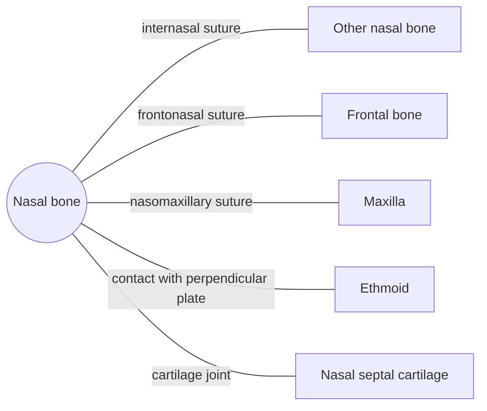

# Nasal bone

## Summary

The two small nasal bones form the bridge of the nose. Below them, the shape of the nose is made of cartilage. They are the most commonly fractured bones of the face.

## Prerequisites

- [Skull overview](skull-overview.md)

## Core concepts

### Definition

The *nasal bone* is a paired, small, oblong flat bone of the viscerocranium. The two bones meet in the midline and form the upper part of the nasal bridge. Latin: *os nasale*.

### Analogy

The nasal bones are like the ridge beam of a small tent: they hold the upper part of the roof, while the lower part (the cartilage of the nose) is flexible fabric. The analogy breaks because the "fabric" can be reshaped surgically while the beam is bone.

### Mechanism

They support the upper nose and protect the upper nasal cavity. Their inner surface is lined with nasal mucosa.

The diagram shows the bones this bone meets and the joints it forms.

### Landmarks

| Landmark | Description |
| --- | --- |
| Nasal bridge | Formed by both bones |
| Internasal suture | Midline joint between them |
| Nasion | Junction with the frontal bone |

### Muscle attachments

Procerus and nasalis muscles lie over it.

## Worked example

A punch to the nose usually breaks the nasal bones because they are thin and project forward. A displaced fracture is often reset within about one to two weeks, before the bones knit in the wrong position.

## Trade offs and when to use it

Their position protects the airway but makes them vulnerable in contact sports.

## Common mistakes

- **Thinking the whole nose is bone.** Only the bridge is bone; the rest is cartilage.

## Practice

1. What forms the lower part of the external nose?
2. Which suture joins the nasal bones to the forehead?

### Answers

1. Cartilage.
2. The frontonasal suture.

## Further reading

- Standring, S. (Ed.) (2020). *Gray's Anatomy: The Anatomical Basis of Clinical Practice (42nd ed.)*. Elsevier. Reference text for attachments, innervation and relations.
- Betts, J. G., Young, K. A., Wise, J. A. et al. (2022). *Anatomy and Physiology 2e*. OpenStax, Rice University. [Link](https://openstax.org/details/books/anatomy-and-physiology-2e). Open textbook with illustrations of the skeletal and muscular systems.
