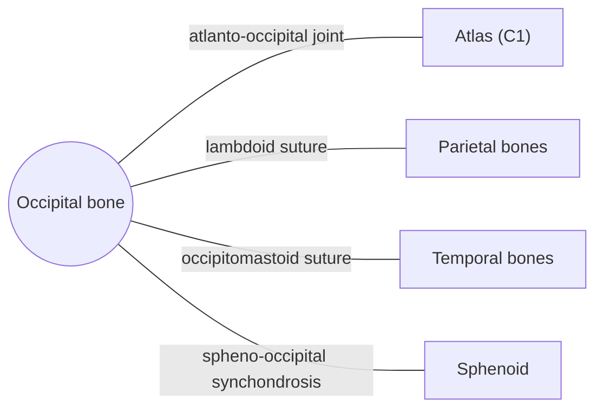

# Occipital bone

## Summary

The occipital bone forms the back and lower part of the skull. Its large opening, the foramen magnum, lets the spinal cord join the brainstem, and its condyles rest on the atlas, forming the joint for nodding.

## Prerequisites

- [Skull overview](skull-overview.md)

## Core concepts

### Definition

The *occipital bone* is an unpaired, saucer-shaped bone of the neurocranium with four parts around the foramen magnum: the squamous part behind, two lateral (condylar) parts and the basilar part in front. Latin: *os occipitale*.

### Analogy

The occipital bone is like the back plate and base ring of a lamp: the cable (spinal cord) passes through the ring (foramen magnum) and the lamp sits on two rockers (occipital condyles) that let it tilt forward and back. The analogy breaks because the rockers also carry the full weight of the head on a living joint.

### Mechanism

It protects the occipital lobes and cerebellum, transmits the spinal cord, vertebral arteries and accessory nerves through the foramen magnum, forms the atlanto-occipital joints with the atlas, and anchors the neck extensors and the trapezius.

The diagram shows the bones this bone meets and the joints it forms.

### Landmarks

| Landmark | Description |
| --- | --- |
| Foramen magnum | Opening for the medulla, vertebral arteries and spinal roots of the accessory nerve |
| Occipital condyles | Articulate with the atlas |
| External occipital protuberance (inion) | Bump at the back of the skull; attachment of the ligamentum nuchae and trapezius |
| Superior and inferior nuchal lines | Attachments of neck muscles |
| Hypoglossal canal | Passage of cranial nerve XII |
| Basilar part (clivus) | Slope supporting the brainstem; front edge of foramen magnum |

### Muscle attachments

Trapezius, semispinalis capitis, splenius capitis (lateral), rectus capitis posterior major and minor, obliquus capitis superior, rectus capitis anterior and lateralis, longus capitis, occipital belly of occipitofrontalis.

## Worked example

Nodding "yes" happens mainly at the atlanto-occipital joints, where the convex occipital condyles roll in the concave superior facets of the atlas. About 15 to 25 degrees of flexion and extension take place there.

## Trade offs and when to use it

The foramen magnum is a tight passage; if the cerebellum is pushed down into it (Chiari malformation or raised pressure), it compresses the brainstem.

## Common mistakes

- **Calling the inion the occipital condyle.** The inion is the external bump; the condyles are on the underside.

## Practice

1. What passes through the foramen magnum?
2. With which vertebra does the occipital bone articulate?

### Answers

1. The medulla oblongata (continuing as the spinal cord), the vertebral arteries and the spinal roots of the accessory nerve.
2. The atlas (C1).

## Further reading

- Standring, S. (Ed.) (2020). *Gray's Anatomy: The Anatomical Basis of Clinical Practice (42nd ed.)*. Elsevier. Reference text for attachments, innervation and relations.
- Betts, J. G., Young, K. A., Wise, J. A. et al. (2022). *Anatomy and Physiology 2e*. OpenStax, Rice University. [Link](https://openstax.org/details/books/anatomy-and-physiology-2e). Open textbook with illustrations of the skeletal and muscular systems.
