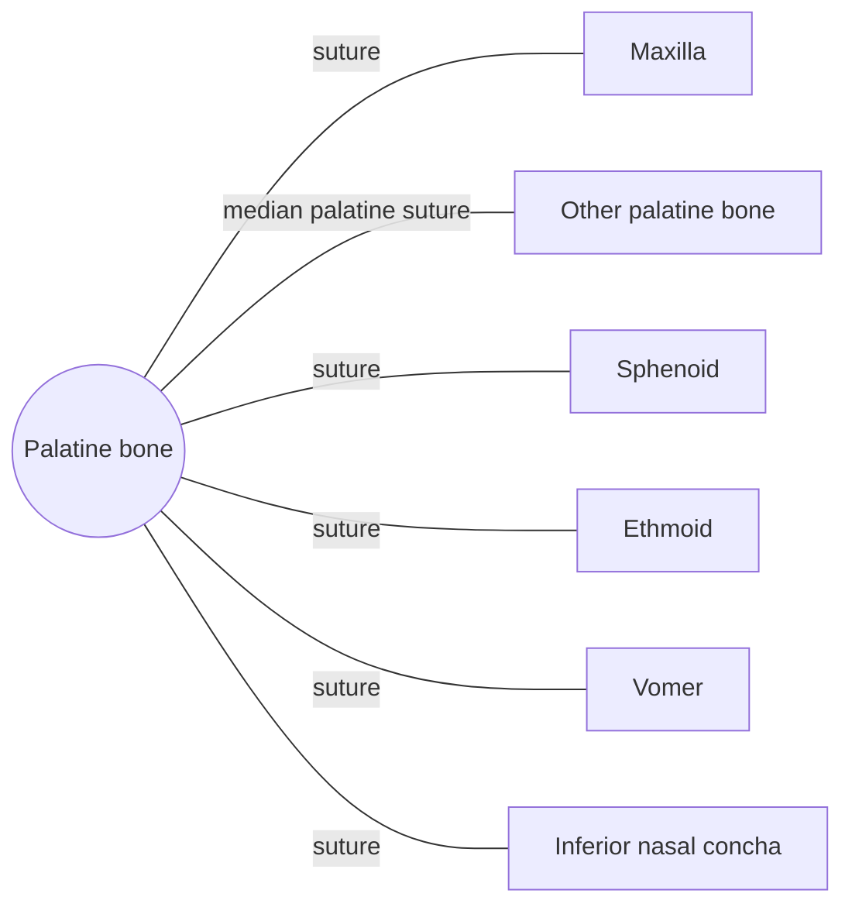

# Palatine bone

## Summary

The two L-shaped palatine bones form the back third of the hard palate and parts of the nasal cavity walls and the orbit floor. They separate the mouth from the nose at the back.

## Prerequisites

- [Skull overview](skull-overview.md)

## Core concepts

### Definition

The *palatine bone* is a paired, L-shaped bone of the viscerocranium with a horizontal plate (back of the hard palate) and a perpendicular plate (side wall of the nasal cavity). Latin: *os palatinum*.

### Analogy

The palatine bones are like the back section of a floor that separates two levels of a house, the nasal cavity above and the mouth below. The analogy breaks because the floor continues backward as a soft, movable flap (the soft palate) attached to its edge.

### Mechanism

The horizontal plates join in the midline and attach the soft palate. The greater and lesser palatine foramina pass nerves and vessels to the palate.

The diagram shows the bones this bone meets and the joints it forms.

### Landmarks

| Landmark | Description |
| --- | --- |
| Horizontal plate | Back third of the hard palate |
| Perpendicular plate | Lateral wall of nasal cavity |
| Greater and lesser palatine foramina | Nerves and vessels to the palate |
| Posterior nasal spine | Attachment of the uvula muscle |

### Muscle attachments

Tensor veli palatini (via aponeurosis), musculus uvulae, medial pterygoid (pyramidal process).

## Worked example

In cleft palate, the palatine processes of the maxillae and the palatine bones fail to fuse during fetal development, leaving an opening between mouth and nose that makes feeding and speech difficult until surgical repair, usually in the first year.

## Trade offs and when to use it

No notable trade offs; the bone is small and well protected.

## Common mistakes

- **Thinking the whole palate is one bone.** The hard palate is formed by the maxillae in front and the palatine bones behind.

## Practice

1. What part of the hard palate do the palatine bones form?
2. What attaches to the back edge of the hard palate?

### Answers

1. The back third.
2. The soft palate.

## Further reading

- Standring, S. (Ed.) (2020). *Gray's Anatomy: The Anatomical Basis of Clinical Practice (42nd ed.)*. Elsevier. Reference text for attachments, innervation and relations.
- Betts, J. G., Young, K. A., Wise, J. A. et al. (2022). *Anatomy and Physiology 2e*. OpenStax, Rice University. [Link](https://openstax.org/details/books/anatomy-and-physiology-2e). Open textbook with illustrations of the skeletal and muscular systems.
