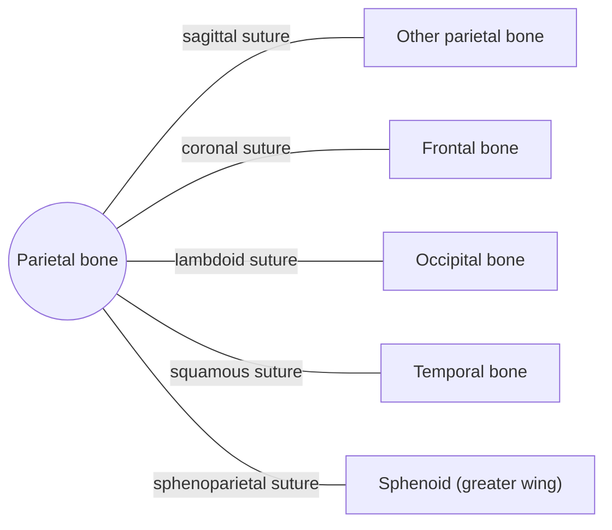

# Parietal bone

## Summary

The two parietal bones form most of the roof and sides of the skull vault. They meet in the midline at the sagittal suture and protect the parietal lobes of the brain.

## Prerequisites

- [Skull overview](skull-overview.md)

## Core concepts

### Definition

The *parietal bone* is a paired, four-sided, curved flat bone of the neurocranium. Its outer surface is convex and smooth; its inner surface carries grooves for the meningeal vessels. Latin: *os parietale*.

### Analogy

The parietal bones are like the two halves of a dome roof joined at the ridge. The analogy breaks because the "roof" also grows outward at its seams (sutures) during childhood.

### Mechanism

They shield the upper brain and give origin to the temporalis muscle along the temporal lines. The grooves on their inner surface carry branches of the middle meningeal artery.

The diagram shows the bones this bone meets and the joints it forms.

### Landmarks

| Landmark | Description |
| --- | --- |
| Parietal eminence | Most convex point of the outer surface |
| Superior and inferior temporal lines | Attachment of temporal fascia and temporalis |
| Grooves for middle meningeal vessels | On the inner surface |
| Parietal foramen | Small opening near the sagittal suture for an emissary vein |

### Muscle attachments

Temporalis (from the temporal lines).

## Worked example

In a newborn, the anterior fontanelle (the "soft spot") lies where the two parietal bones meet the frontal bone. A sunken fontanelle can indicate dehydration, and a bulging one raised pressure inside the skull.

## Trade offs and when to use it

The broad, thin parietal bones are light, but they fracture more easily than the thick base.

## Common mistakes

- **Calling the sagittal suture a fracture line on an infant X-ray.** Open sutures are normal in children.

## Practice

1. Which suture lies between the two parietal bones?
2. Which lobe of the brain lies beneath the parietal bone?

### Answers

1. The sagittal suture.
2. The parietal lobe.

## Further reading

- Standring, S. (Ed.) (2020). *Gray's Anatomy: The Anatomical Basis of Clinical Practice (42nd ed.)*. Elsevier. Reference text for attachments, innervation and relations.
- Betts, J. G., Young, K. A., Wise, J. A. et al. (2022). *Anatomy and Physiology 2e*. OpenStax, Rice University. [Link](https://openstax.org/details/books/anatomy-and-physiology-2e). Open textbook with illustrations of the skeletal and muscular systems.
