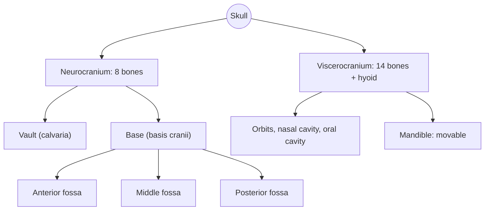

# Skull overview

## Summary

The skull (*cranium*) is the bony skeleton of the head and the natural shield of the brain and the other organs in the head. It consists of the neurocranium, which encloses the brain (8 bones), and the viscerocranium or facial skeleton (14 bones, plus the hyoid in some classifications). Most skull bones are joined by immovable sutures; only the mandible moves freely. The skull grows throughout fetal life and until adulthood, fastest in the first three years, and its growth slows once the fontanelles and then the sutures close.

## Prerequisites

- [Skeletal system overview](../skeletal-system-overview.md)

## Core concepts

### Definition

The *skull* is the bony (in early development partly cartilaginous) structure that forms the skeleton of the head. In humans and other primates it consists of:

- the **neurocranium** (*neurocranium*, braincase), every bone of which touches the brain. It is box-shaped, with an upper part, the vault (*calvaria*), a lower part, the base (*basis cranii*), and four walls: front, back and two sides;
- the **viscerocranium** (*viscerocranium*), also called the splanchnocranium, the facial skeleton.

The inner surface of the cranial base (*basis cranii interna*) is divided into three steps: the anterior, middle and posterior cranial fossae.

### Analogy

The skull is like a crash helmet with a built-in face mask. The helmet shell (vault) is made of curved plates glued along zigzag seams (sutures), which spreads impact forces. The floor of the helmet (cranial base) has holes for cables (nerves) and pipes (vessels). The face mask (viscerocranium) protects the eyes, nose and mouth and carries the jaw. The analogy breaks because the helmet of a baby has soft gaps (fontanelles) that let it squeeze through the birth canal and grow with the brain.

### Mechanism

**Neurocranium** (protects the brain), 8 bones:

- [Frontal bone](frontal-bone.md) (*os frontale*), 1
- [Parietal bones](parietal-bone.md) (*ossa parietalia*), 2
- [Temporal bones](temporal-bone.md) (*ossa temporalia*), 2
- [Occipital bone](occipital-bone.md) (*os occipitale*), 1
- [Sphenoid bone](sphenoid-bone.md) (*os sphenoidale*), 1
- [Ethmoid bone](ethmoid-bone.md) (*os ethmoidale*), 1

**Viscerocranium** (protects the organs of sight, smell and taste and surrounds the beginning of the airway and digestive tract), 14 bones plus the hyoid:

- [Nasal bones](nasal-bone.md) (*os nasale*), 2
- [Lacrimal bones](lacrimal-bone.md) (*os lacrimale*), 2
- [Inferior nasal conchae](inferior-nasal-concha.md) (*concha nasalis inferior*), 2
- [Vomer](vomer.md) (*vomer*), 1
- [Maxillae](maxilla.md) (*maxilla*), 2
- [Mandible](mandible.md) (*mandibula*), 1
- [Palatine bones](palatine-bone.md) (*os palatinum*), 2
- [Zygomatic bones](zygomatic-bone.md) (*os zygomaticum*), 2
- [Hyoid bone](hyoid-bone.md) (*os hyoideum*), 1. Many textbooks count it separately, because it does not touch any other bone.

The movable elements of the facial skeleton are the unpaired mandible, which carries the lower teeth, and the hyoid bone, which has no bony connection to the rest of the skull.

**Joints.** The skull bones are joined by *sutures*, fixed fibrous joints, such as the coronal suture (frontal and parietal bones), the sagittal suture (between the parietals), the lambdoid suture (parietals and occipital) and the squamous suture (temporal and parietal). Some bones of the base are joined by *synchondroses* (cartilaginous joints) that ossify with age, such as the spheno-occipital synchondrosis, which closes in the late teens. The only synovial joint is the [Temporomandibular joint](../../joints/temporomandibular-joint.md).

**Growth.** At birth, gaps between the vault bones are closed only by membrane: the *fontanelles*. The posterior fontanelle closes at about 2 to 3 months and the anterior at about 18 to 24 months. Sutures stay open as growth zones and fuse mostly in adulthood. Skull growth is most intense in the first three years, matching brain growth.

The diagram shows the structure of the skull.

### Cranial fossae

| Fossa | Formed by | Holds |
| --- | --- | --- |
| Anterior | Frontal, ethmoid, lesser wings of sphenoid | Frontal lobes of the brain |
| Middle | Body and greater wings of sphenoid, temporal bones | Temporal lobes, pituitary gland in the sella turcica |
| Posterior | Occipital and temporal bones | Cerebellum, brainstem; foramen magnum for the spinal cord |

## Worked example

A blow to the side of the head at the *pterion*, the H-shaped junction of the frontal, parietal, temporal and sphenoid bones, is particularly dangerous. The bone there is thin, and the middle meningeal artery runs just inside. A fracture can tear the artery and cause an epidural hematoma, in which blood collects between the skull and the dura. A person may seem fine for a while (a "lucid interval") and then deteriorate rapidly, which is why head injuries at this point need prompt assessment.

## Trade offs and when to use it

- Sutures and fontanelles allow birth and brain growth but make the infant skull vulnerable. Premature fusion of a suture (craniosynostosis) distorts skull shape and may need surgery.

## Common mistakes

- **Counting the hyoid as a skull bone without saying so.** Classifications differ.
- **Thinking the skull is one bone.** Only in adults are most sutures fused, and some never fully fuse.

## Practice

1. Name the six types of bone in the neurocranium.
2. Which two skull bones move?
3. Which fossa holds the cerebellum?

### Answers

1. Frontal, parietal, temporal, occipital, sphenoid and ethmoid.
2. The mandible and the hyoid bone (which is not attached to other bones).
3. The posterior cranial fossa.

## Further reading

- Standring, S. (Ed.) (2020). *Gray's Anatomy: The Anatomical Basis of Clinical Practice (42nd ed.)*. Elsevier. Reference text for attachments, innervation and relations.
- Betts, J. G., Young, K. A., Wise, J. A. et al. (2022). *Anatomy and Physiology 2e*. OpenStax, Rice University. [Link](https://openstax.org/details/books/anatomy-and-physiology-2e). Open textbook with illustrations of the skeletal and muscular systems.
