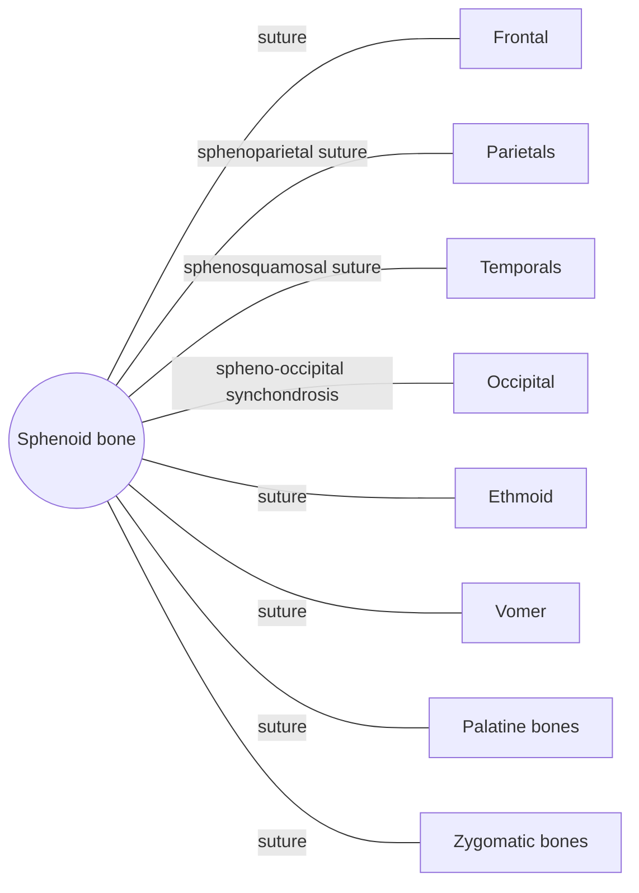

# Sphenoid bone

## Summary

The sphenoid is a butterfly-shaped bone at the center of the skull base that touches all other cranial bones. It forms part of the orbits and the side walls of the skull, holds the pituitary gland in the sella turcica and gives passage to many nerves and vessels.

## Prerequisites

- [Skull overview](skull-overview.md)

## Core concepts

### Definition

The *sphenoid bone* ("wedge-shaped") is an unpaired, irregular bone of the neurocranium. It has a central body with the sphenoid sinus, two greater wings, two lesser wings and two pterygoid processes that point downward. Latin: *os sphenoidale*.

### Analogy

The sphenoid is like the keystone of an arch, wedged between all the other cranial bones and holding them together. The analogy breaks because this keystone is full of holes, which carry nerves to the eyes and face.

### Mechanism

Its body contains the sphenoid sinus and the sella turcica, a saddle-shaped seat for the pituitary gland. Its foramina pass the optic nerve (optic canal), the nerves that move the eye and part of the trigeminal nerve (superior orbital fissure, foramen rotundum, foramen ovale) and the middle meningeal artery (foramen spinosum). The pterygoid processes anchor the pterygoid muscles of chewing.

The diagram shows the bones this bone meets and the joints it forms.

### Landmarks

| Landmark | Description |
| --- | --- |
| Body and sphenoid sinus | Central part with an air space |
| Sella turcica | Saddle holding the pituitary gland |
| Lesser wings and optic canal | Optic nerve and ophthalmic artery |
| Greater wings | Side walls of skull and orbit; foramen rotundum, ovale and spinosum |
| Superior orbital fissure | Cranial nerves III, IV, V1, VI |
| Pterygoid processes | Medial and lateral plates for pterygoid muscles |

### Muscle attachments

Medial and lateral pterygoid muscles, temporalis (greater wing), extraocular muscles (common tendinous ring around the optic canal), tensor veli palatini.

## Worked example

Surgeons often reach pituitary tumors through the nose and the sphenoid sinus (transsphenoidal surgery), because the sella turcica lies just above and behind the sinus. This avoids opening the skull.

## Trade offs and when to use it

Its central position makes it a structural key and a corridor for nerves, so fractures of the skull base through the sphenoid can damage vision and eye movement.

## Common mistakes

- **Calling it the "spheroid" bone.** The name is sphenoid, meaning wedge-shaped.

## Practice

1. Which gland sits in the sella turcica?
2. Through which opening does the optic nerve pass?

### Answers

1. The pituitary gland.
2. The optic canal in the lesser wing of the sphenoid.

## Further reading

- Standring, S. (Ed.) (2020). *Gray's Anatomy: The Anatomical Basis of Clinical Practice (42nd ed.)*. Elsevier. Reference text for attachments, innervation and relations.
- Betts, J. G., Young, K. A., Wise, J. A. et al. (2022). *Anatomy and Physiology 2e*. OpenStax, Rice University. [Link](https://openstax.org/details/books/anatomy-and-physiology-2e). Open textbook with illustrations of the skeletal and muscular systems.
