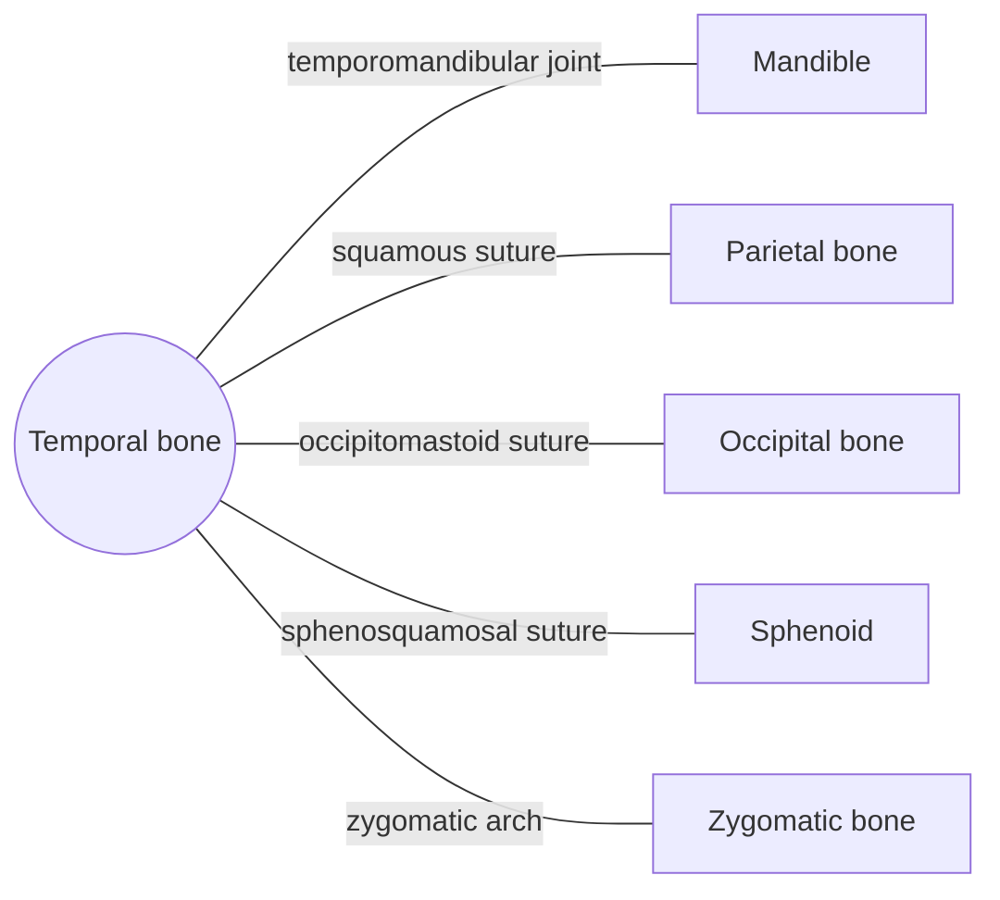

# Temporal bone

## Summary

The paired temporal bones form the lower sides of the skull and part of its base. They house the organs of hearing and balance, form the socket of the jaw joint and carry the mastoid process, where the sternocleidomastoid attaches.

## Prerequisites

- [Skull overview](skull-overview.md)

## Core concepts

### Definition

The *temporal bone* is a paired, irregular bone of the neurocranium made of four parts: the squamous part (flat side wall), the tympanic part (around the ear canal), the petrous part (a dense pyramid containing the inner ear) and the mastoid part, plus the styloid process. Latin: *os temporale*.

### Analogy

The temporal bone is like a vault safe built into the side wall of a house: its petrous part, among the densest bone in the body, protects the delicate hearing and balance organs. The analogy breaks because this safe also has open channels for sound (the ear canal) and for nerves and vessels.

### Mechanism

The petrous part contains the cochlea, the semicircular canals and the middle ear ossicles. The mandibular fossa forms the temporomandibular joint with the mandible. The mastoid process contains air cells connected to the middle ear and anchors neck muscles. The styloid process anchors muscles of the tongue and pharynx and the stylohyoid ligament.

The diagram shows the bones this bone meets and the joints it forms.

### Landmarks

| Landmark | Description |
| --- | --- |
| Squamous part | Thin side wall; zygomatic process |
| Mandibular fossa and articular tubercle | Socket and front stop of the jaw joint |
| External acoustic meatus | Bony ear canal |
| Petrous part | Contains inner ear; internal acoustic meatus for facial and vestibulocochlear nerves |
| Mastoid process and mastoid notch | Attachments of sternocleidomastoid and posterior belly of digastric |
| Styloid process | Attachment of stylohyoid, styloglossus, stylopharyngeus |
| Carotid canal | Passage of the internal carotid artery |

### Muscle attachments

Temporalis, masseter (via the zygomatic arch), sternocleidomastoid, splenius capitis, longissimus capitis, posterior belly of digastric (mastoid notch), stylohyoid.

## Worked example

Middle ear infections can spread into the mastoid air cells (mastoiditis), causing pain, swelling and redness behind the ear. Before antibiotics this was a common reason for surgery.

## Trade offs and when to use it

Its complex shape packs many structures into a small space, which makes fractures of the temporal bone risky for hearing, balance and the facial nerve.

## Common mistakes

- **Thinking the jaw joint is formed with the zygomatic bone.** It is formed by the mandible and the mandibular fossa of the temporal bone.

## Practice

1. Which part of the temporal bone contains the inner ear?
2. Which muscle attaches to the mastoid process?

### Answers

1. The petrous part.
2. Sternocleidomastoid (also splenius capitis and longissimus capitis).

## Further reading

- Standring, S. (Ed.) (2020). *Gray's Anatomy: The Anatomical Basis of Clinical Practice (42nd ed.)*. Elsevier. Reference text for attachments, innervation and relations.
- Betts, J. G., Young, K. A., Wise, J. A. et al. (2022). *Anatomy and Physiology 2e*. OpenStax, Rice University. [Link](https://openstax.org/details/books/anatomy-and-physiology-2e). Open textbook with illustrations of the skeletal and muscular systems.
