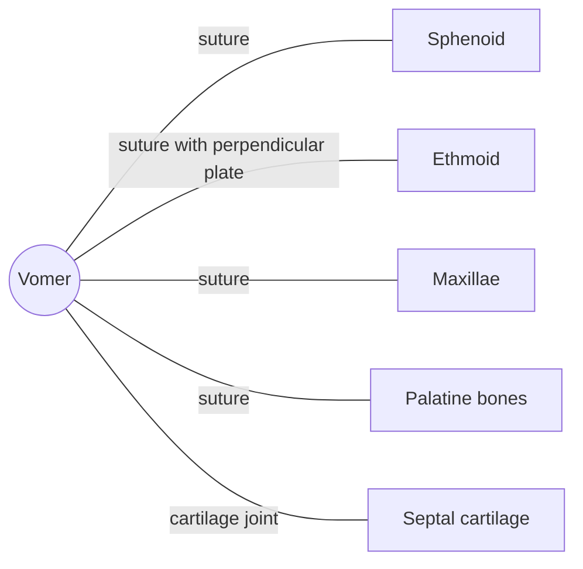

# Vomer

## Summary

The vomer is a thin, unpaired bone that forms the lower and back part of the nasal septum, the wall dividing the nasal cavity into left and right halves. Its name means "plowshare" because of its shape.

## Prerequisites

- [Skull overview](skull-overview.md)

## Core concepts

### Definition

The *vomer* is an unpaired flat bone of the viscerocranium in the midline of the nasal cavity. Together with the perpendicular plate of the ethmoid and the septal cartilage, it forms the nasal septum. Latin: *vomer*.

### Analogy

The vomer is like the lower part of a partition wall that splits a room in two, with the ethmoid as the upper part and cartilage as the front section. The analogy breaks because this wall is often slightly bent (deviated) without causing problems.

### Mechanism

It divides the posterior nasal openings (choanae) and anchors the septal cartilage.

The diagram shows the bones this bone meets and the joints it forms.

### Landmarks

| Landmark | Description |
| --- | --- |
| Alae | Wings at the upper edge meeting the sphenoid |
| Posterior border | Free edge separating the choanae |

## Worked example

A deviated septum is present to some degree in most adults. If it blocks breathing on one side, a septoplasty straightens or removes part of the cartilage and bone, including parts of the vomer.

## Trade offs and when to use it

A mild deviation is normal and needs no treatment.

## Common mistakes

- **Thinking the nasal septum is entirely cartilage.** Its back and lower parts are bone: the vomer and the ethmoid.

## Practice

1. Which three structures form the nasal septum?
2. What does the word vomer mean?

### Answers

1. The vomer, the perpendicular plate of the ethmoid and the septal cartilage.
2. Plowshare.

## Further reading

- Standring, S. (Ed.) (2020). *Gray's Anatomy: The Anatomical Basis of Clinical Practice (42nd ed.)*. Elsevier. Reference text for attachments, innervation and relations.
- Betts, J. G., Young, K. A., Wise, J. A. et al. (2022). *Anatomy and Physiology 2e*. OpenStax, Rice University. [Link](https://openstax.org/details/books/anatomy-and-physiology-2e). Open textbook with illustrations of the skeletal and muscular systems.
