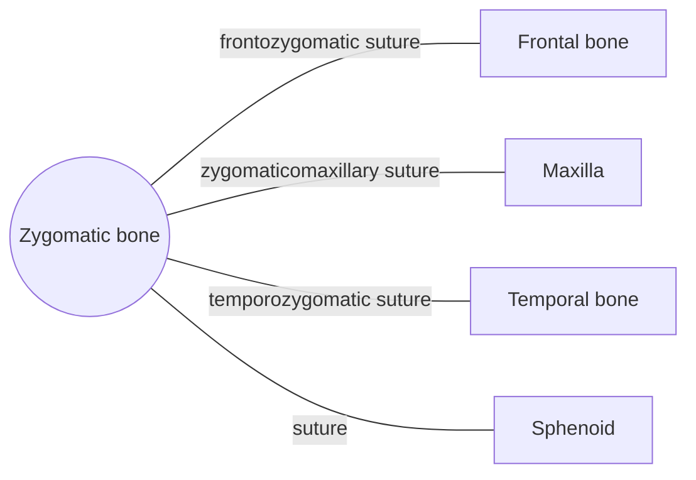

# Zygomatic bone

## Summary

The zygomatic bones are the cheekbones. Each forms the prominence of the cheek, part of the outer wall and floor of the orbit, and, with the temporal bone, the zygomatic arch, from which the masseter muscle starts.

## Prerequisites

- [Skull overview](skull-overview.md)

## Core concepts

### Definition

The *zygomatic bone* is a paired, irregular bone of the viscerocranium with frontal, temporal and maxillary processes. Latin: *os zygomaticum*.

### Analogy

The zygomatic arch is like a flying buttress on a cathedral, a bony bridge that spans from the face to the side of the skull and carries the pull of the chewing muscle. The analogy breaks because a buttress resists outward thrust, while the arch resists the downward pull of the masseter.

### Mechanism

Its temporal process joins the zygomatic process of the temporal bone to form the zygomatic arch. The masseter originates from the lower edge of the arch, and the temporal fascia attaches above it.

The diagram shows the bones this bone meets and the joints it forms.

### Landmarks

| Landmark | Description |
| --- | --- |
| Body | Prominence of the cheek |
| Frontal process | Lateral orbital rim |
| Temporal process | Front part of the zygomatic arch |
| Zygomaticofacial foramen | Sensory nerve to the cheek |

### Muscle attachments

Masseter, zygomaticus major and minor, levator labii superioris (in part).

## Worked example

A fracture of the cheekbone ("tripod fracture") breaks the bone at its three or four connections. Signs include a flattened cheek, numbness over the cheek and upper lip (infraorbital nerve), and sometimes double vision if the orbit floor is involved.

## Trade offs and when to use it

Its prominence protects the eye from the side but takes many blows in falls and fights.

## Common mistakes

- **Saying the zygomatic arch is a single bone.** It is formed by the zygomatic and temporal bones.

## Practice

1. Which muscle originates from the zygomatic arch?
2. Which two bones form the zygomatic arch?

### Answers

1. The masseter.
2. The zygomatic and temporal bones.

## Further reading

- Standring, S. (Ed.) (2020). *Gray's Anatomy: The Anatomical Basis of Clinical Practice (42nd ed.)*. Elsevier. Reference text for attachments, innervation and relations.
- Betts, J. G., Young, K. A., Wise, J. A. et al. (2022). *Anatomy and Physiology 2e*. OpenStax, Rice University. [Link](https://openstax.org/details/books/anatomy-and-physiology-2e). Open textbook with illustrations of the skeletal and muscular systems.
