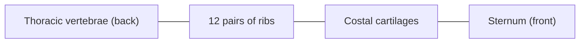

# Thorax

The bony thorax (rib cage) is formed by the 12 thoracic vertebrae, 12 pairs of ribs with their costal cartilages, and the sternum. It protects the heart, lungs and great vessels and moves with every breath.

## Map

## Reading order

1. [Sternum](sternum.md): the breastbone.
2. [Ribs](ribs.md): true, false and floating ribs and their joints.

The vertebrae are covered in [Thoracic vertebrae](../vertebral-column/thoracic-vertebrae.md), and the mechanics of breathing in [Mechanics of breathing](../../../physiology/respiration/mechanics-of-breathing.md).
