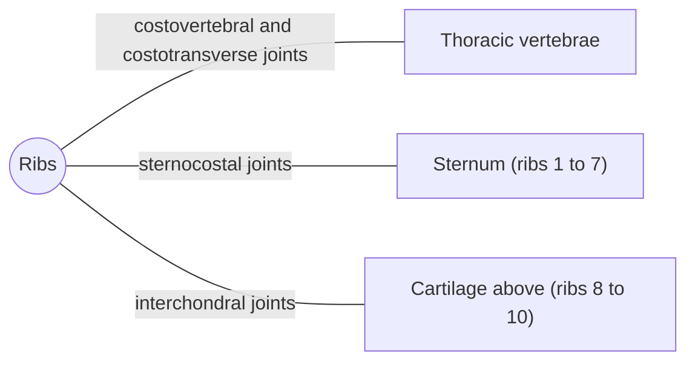

# Ribs

## Summary

Humans have 12 pairs of ribs, curved flat bones that form most of the rib cage. Ribs 1 to 7 attach directly to the sternum through their own cartilages (true ribs), ribs 8 to 10 attach through the cartilage above (false ribs), and ribs 11 and 12 end free in the abdominal wall (floating ribs). Each rib moves at its joints with the spine during breathing.

## Prerequisites

- [Sternum](sternum.md)

## Core concepts

### Definition

A *rib* is a curved flat bone running from a thoracic vertebra around the chest. A typical rib has a head, neck, tubercle, angle and shaft, and continues in front as a *costal cartilage*. Latin: *costae*.

### Analogy

The ribs are like the handles of buckets hanging on the sides of the chest. When the intercostal muscles lift them, the lower ribs swing up and out like a bucket handle, widening the chest from side to side, and the upper ribs move forward like a pump handle, deepening it. The analogy breaks because ribs also twist slightly and bend at their cartilages.

### Mechanism

The head of a typical rib articulates with two vertebral bodies and the disc between them (costovertebral joint), and the tubercle with the transverse process (costotransverse joint). Rotation around the axis through these two joints moves the rib up and down. The costal groove on the inner lower edge protects the intercostal nerve, artery and vein, which is why needles are inserted along the upper edge of a rib.

The diagram shows the bones this bone meets and the joints it forms.

### Landmarks

| Landmark | Description |
| --- | --- |
| Head | Two facets for vertebral bodies (typical ribs) |
| Neck | Between head and tubercle |
| Tubercle | Joins the transverse process |
| Angle | Point of sharpest curvature |
| Shaft | Thin, curved |
| Costal groove | Lower inner edge; intercostal vessels and nerve |
| Costal cartilage | Connects to the sternum or the cartilage above |

### Muscle attachments

Intercostal muscles, diaphragm (lower six cartilages), serratus anterior (ribs 1 to 8 or 9), pectoralis minor (ribs 3 to 5), scalenes (ribs 1 and 2), external and internal obliques, latissimus dorsi (lower ribs), quadratus lumborum (rib 12), levatores costarum.

### Types of ribs

| Type | Ribs | Attachment in front |
| --- | --- | --- |
| True (vertebrosternal) | 1 to 7 | Own cartilage to the sternum |
| False (vertebrochondral) | 8 to 10 | Cartilage joins the cartilage above |
| Floating (vertebral) | 11 and 12 | Free ends in the abdominal wall |

Ribs 1, 2, 10, 11 and 12 are atypical: the first rib is short, broad and flat and carries grooves for the subclavian artery and vein, and ribs 10 to 12 have a single facet on the head.

## Worked example

Rib fractures are most common in the middle ribs (about 4 to 9), at the angle, where the rib is weakest. They are painful mainly because breathing moves them. Fractures of the lower ribs raise suspicion of injury to the liver or spleen, and fractures of the first rib signal high-energy trauma.

## Trade offs and when to use it

The cage protects organs but must expand about 3 to 5 cm in circumference with each deep breath; stiffness from age or disease reduces lung capacity.

## Common mistakes

- **Thinking floating ribs are loose.** They articulate with the vertebrae; only their front ends are free.

## Practice

1. How many pairs of true ribs are there?
2. Why are needles inserted along the upper edge of a rib?
3. Which ribs move mainly in a bucket-handle way?

### Answers

1. Seven.
2. The intercostal vessels and nerve run in the costal groove at the lower edge.
3. The lower ribs.

## Further reading

- Standring, S. (Ed.) (2020). *Gray's Anatomy: The Anatomical Basis of Clinical Practice (42nd ed.)*. Elsevier. Reference text for attachments, innervation and relations.
- Betts, J. G., Young, K. A., Wise, J. A. et al. (2022). *Anatomy and Physiology 2e*. OpenStax, Rice University. [Link](https://openstax.org/details/books/anatomy-and-physiology-2e). Open textbook with illustrations of the skeletal and muscular systems.
