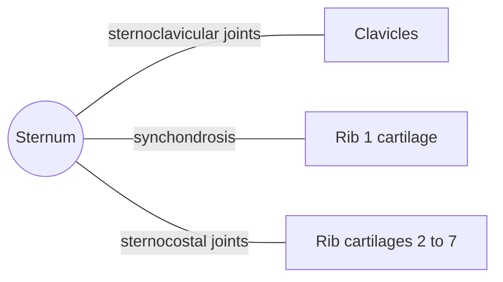

# Sternum

## Summary

The sternum (breastbone) is the flat, unpaired bone in the middle of the front of the chest. It has three parts: the manubrium, the body and the xiphoid process. The clavicles and the costal cartilages of the upper seven ribs attach to it. In children the three parts are joined by cartilage, which ossifies with age into bony fusion.

## Prerequisites

- [Skeletal system overview](../skeletal-system-overview.md)

## Core concepts

### Definition

The *sternum* is an unpaired, long, flat bone forming the middle of the front wall of the thorax. Its parts are the *manubrium* (handle), the *body* (*corpus*) and the *xiphoid process*. In children a cartilaginous joint (synchondrosis) joins the parts, and with age it ossifies into a bony union (synostosis). Latin: *sternum*.

### Analogy

The sternum is like the front buckle of a harness: the straps (ribs) from both sides converge and fasten to it, holding the cage together. The analogy breaks because the "buckle" moves up and forward with each deep breath.

### Mechanism

The manubrium joins the clavicles at the sternoclavicular joints and the first rib cartilage. The *sternal angle* (angle of Louis), the slight ridge between manubrium and body, marks the level of the second rib, a key landmark for counting ribs. The body takes the cartilages of ribs 2 to 7. The xiphoid process is cartilaginous in youth and ossifies later.

The diagram shows the bones this bone meets and the joints it forms.

### Landmarks

| Landmark | Description |
| --- | --- |
| Jugular (suprasternal) notch | Upper edge of the manubrium, palpable at the base of the neck |
| Clavicular notches | Sternoclavicular joints |
| Sternal angle | Junction of manubrium and body, at the level of rib 2 |
| Body | Costal notches for ribs 2 to 7 |
| Xiphoid process | Lower tip; attachment for the diaphragm and linea alba |

### Muscle attachments

Pectoralis major, sternocleidomastoid (sternal head), sternohyoid and sternothyroid (back of manubrium), transversus thoracis, rectus abdominis (xiphoid and cartilages), diaphragm (xiphoid).

## Worked example

In cardiopulmonary resuscitation (CPR), compressions are given on the lower half of the sternum to a depth of about 5 to 6 cm in adults, at 100 to 120 per minute. Pressing on the xiphoid process is avoided because it can break off and injure the liver. The sternum is also opened (sternotomy) for most heart operations.

## Trade offs and when to use it

A central plate protects the heart and anchors the ribs but must stay flexible enough, through the cartilages, for breathing.

## Common mistakes

- **Using the xiphoid as the CPR landmark.** Compress the lower half of the sternum, above the xiphoid.

## Practice

1. Which rib is at the level of the sternal angle?
2. Name the three parts of the sternum.

### Answers

1. The second rib.
2. Manubrium, body and xiphoid process.

## Further reading

- Standring, S. (Ed.) (2020). *Gray's Anatomy: The Anatomical Basis of Clinical Practice (42nd ed.)*. Elsevier. Reference text for attachments, innervation and relations.
- Betts, J. G., Young, K. A., Wise, J. A. et al. (2022). *Anatomy and Physiology 2e*. OpenStax, Rice University. [Link](https://openstax.org/details/books/anatomy-and-physiology-2e). Open textbook with illustrations of the skeletal and muscular systems.
