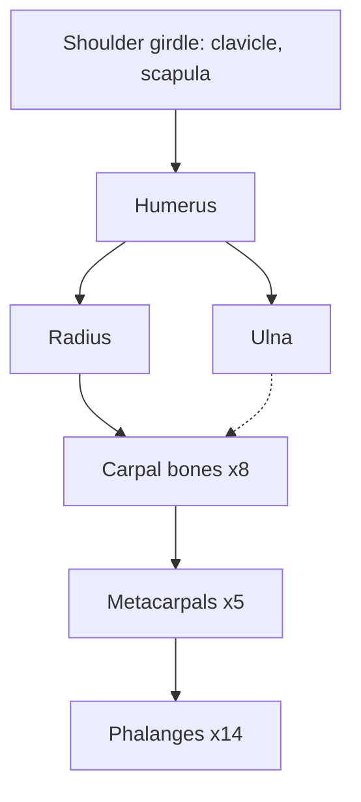

# Upper limb bones

The upper limb is built for reach and manipulation rather than weight bearing. Its 32 bones on each side (including the shoulder girdle) are the clavicle and scapula, the humerus, the radius and ulna, 8 carpal bones, 5 metacarpals and 14 phalanges.

## Map

## Reading order

1. [Clavicle](clavicle.md)
2. [Scapula](scapula.md)
3. [Humerus](humerus.md)
4. [Radius](radius.md)
5. [Ulna](ulna.md)
6. [Carpal bones](carpal-bones.md)
7. [Metacarpals and phalanges of the hand](hand-bones.md): metacarpals and phalanges.
