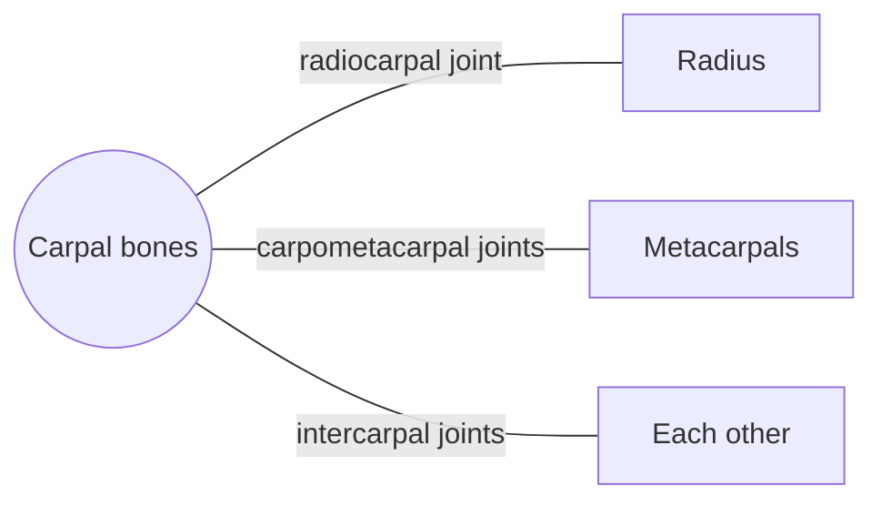

# Carpal bones

## Summary

The eight carpal bones form the wrist in two rows of four. The proximal row (scaphoid, lunate, triquetrum, pisiform) meets the radius; the distal row (trapezium, trapezoid, capitate, hamate) meets the metacarpals. They form an arch whose hollow is roofed by a ligament to create the carpal tunnel.

## Prerequisites

- [Skeletal system overview](../skeletal-system-overview.md)

## Core concepts

### Definition

The *carpal bones* are eight short bones of each wrist. Proximal row, from lateral to medial: scaphoid, lunate, triquetrum, pisiform. Distal row: trapezium, trapezoid, capitate, hamate. A common mnemonic is "Some Lovers Try Positions That They Can't Handle". Latin: *ossa carpi*.

### Analogy

The carpal bones are like a bag of marbles held together by elastic bands: many small bones gliding slightly against each other add up to smooth wrist movement in every direction. The analogy breaks because the "marbles" are shaped and tied so that their movements are coordinated, not random.

### Mechanism

The proximal row adapts its position during wrist movement, while the distal row moves with the hand. The flexor retinaculum stretches between the scaphoid and trapezium on one side and the pisiform and hook of the hamate on the other, forming the carpal tunnel for the median nerve and nine flexor tendons.

The diagram shows the bones this bone meets and the joints it forms.

### Landmarks

| Landmark | Description |
| --- | --- |
| Scaphoid | Largest in proximal row; most fractured carpal |
| Lunate | Moon-shaped; can dislocate |
| Triquetrum | Three-cornered |
| Pisiform | Pea-shaped sesamoid in flexor carpi ulnaris tendon |
| Trapezium | Saddle joint with thumb metacarpal |
| Trapezoid | Small, wedge-shaped |
| Capitate | Largest carpal |
| Hamate | Has a hook (hamulus) |

### Muscle attachments

Flexor carpi ulnaris (pisiform, hamate), thenar and hypothenar muscles (from flexor retinaculum, scaphoid, trapezium, pisiform, hamate), adductor pollicis (capitate).

## Worked example

A fall on the outstretched hand with tenderness in the "anatomical snuffbox" (the hollow at the base of the thumb) suggests a scaphoid fracture even if the first X-ray is normal. Because blood enters the scaphoid mainly from its distal end, a fracture can cut off supply to the proximal part, which may die (avascular necrosis). That is why such injuries are immobilized and re-imaged.

## Trade offs and when to use it

Many small bones give flexibility and absorb load but create complex injury patterns.

## Common mistakes

- **Dismissing a sore wrist with a normal X-ray after a fall.** Scaphoid fractures can be invisible at first.

## Practice

1. Which carpal bone is fractured most often?
2. What passes through the carpal tunnel?

### Answers

1. The scaphoid.
2. The median nerve and nine flexor tendons.

## Further reading

- Standring, S. (Ed.) (2020). *Gray's Anatomy: The Anatomical Basis of Clinical Practice (42nd ed.)*. Elsevier. Reference text for attachments, innervation and relations.
- Betts, J. G., Young, K. A., Wise, J. A. et al. (2022). *Anatomy and Physiology 2e*. OpenStax, Rice University. [Link](https://openstax.org/details/books/anatomy-and-physiology-2e). Open textbook with illustrations of the skeletal and muscular systems.
